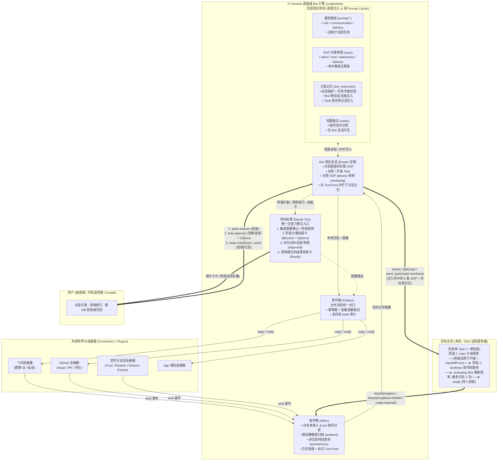
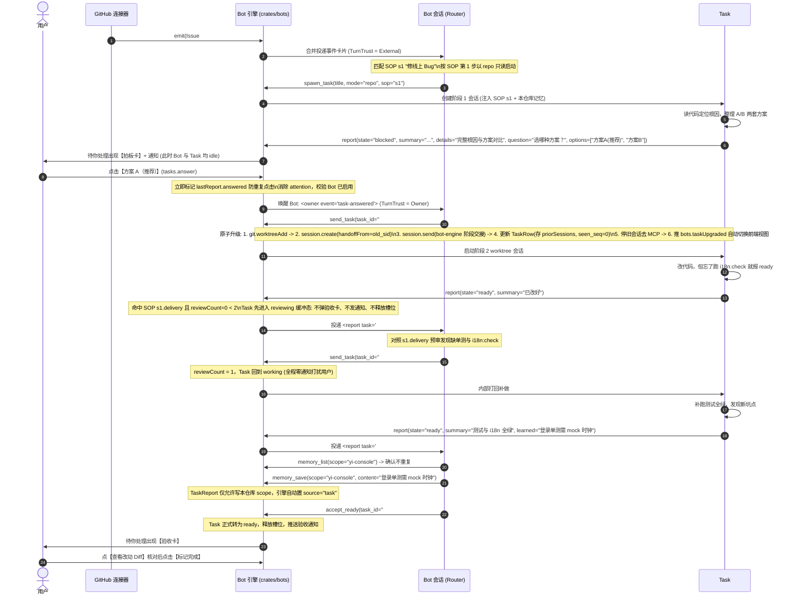
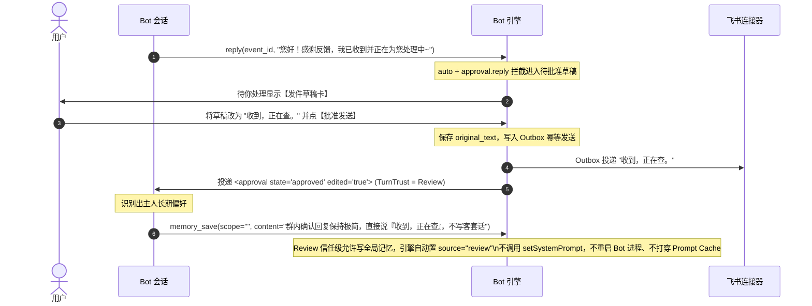
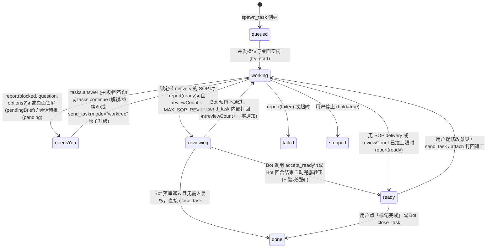

# 方案：Bot 演进（v2）—— SOP、一单到底、分层记忆与统一待办入口

> 状态：修订方案，待评审（保留原稿 [bots-sop.md](bots-sop.md) 不改动；定稿实现后同步更新 `docs/internals/bots.md`（英文）与 `docs/guide.md` / `guide.en.md`（中英文））。
> 基线：建立在现有 `crates/bots`（P1–P5，见 [docs/proposals/bots.md](bots.md) 与 [docs/internals/bots.md](../internals/bots.md)）之上，**零改动 `crates/yi-agentd` 与 `crates/proto`**（直接复用客户端 MCP 桥、`session.create` 的 `handoffFrom`、`client.call` 跨端遥控透传，以及前端文件面板 `showChanges`）。
> 核心理念：延续 DSH SuperAgent —— **人的注意力是唯一预算（Human attention is the budget）**。平时 95% 的时间 AI 在后台静默自治；只在**需要人拍板方向、放行对外动作、验收最终成果（以及敏感配置确认/填密钥）**时通过统一「待你处理」入口打扰人；人每一次介入与纠偏，都在代码级安全护栏下自动沉淀为 SOP 或分层记忆，越用越少打扰人。

### 相对原稿 [bots-sop.md](bots-sop.md) 的核心修订

| 维度 | 原稿问题 | v2 修订做法 |
| :--- | :--- | :--- |
| **概念与信息架构** | 「发件箱」同时承载填密钥、改配置、看 Diff 验收和外部消息队列，语义混杂 | 拆清 **「待你处理（Needs You）」**（决策台）与 **「发件箱（Outbox）」**（对外消息出口：草稿 + 重试队列）；对外插件统一称 **「连接器（插件）」** |
| **SOP 预审状态机** | Task 报 `ready` 立刻改状态并释放槽位，验收卡会提前闪现；缺少最大打回次数 | 引入 **`reviewing` 预审缓冲态** + `accept_ready` 放行 + 回合结束自动兜底转正 + `MAX_SOP_REVIEWS = 2` 熔断 |
| **`repo ➔ worktree` 原地升级** | 先杀旧会话不原子；未清 `seen_seq` 与 `task_busy`；旧会话泄漏成孤儿且阶段 1 上下文丢失；前端停在旧会话 | **先建新后停旧**；复用 `handoffFrom`；归零 `seen_seq` 与 `task_busy`；记录 `priorSessions` 供溯源与统一清理；`report` 增 `details`；推 `bots.taskUpgraded` 自动切页 |
| **记忆安全护栏** | `engine_turn` 允许调用 `memory_save` 且模型自填 `source`，存在持久化 Prompt Injection 后门 | 引入 **`TurnTrust` 四级信任** 代码级拦截（外部事件 turn 禁写，Task 汇报限写本仓库），**`source` 完全由引擎推导** |
| **Prompt Cache 与进程稳定性** | 动态记忆插在 `bot_prompt` 中部，每次 `memory_save` 会打穿 Cache 并触发 `yi-agentd` 杀进程重启 | `bot_prompt` 保持静态稳定；Bot 会话改用类似 `notes` 的**建会话/压缩后 `<memories>` 消息注入**（零重启、保 Cache）；Task 会话静态按仓库注入 |
| **拍板交互与边界** | `tasks.answer` 与锁屏 `pendingBrief` 冲突；情况 B 存在重复点击窗口；漏改旧提示词与 `promptRestore` 回滚冲突 | 区分 `pendingBrief` 与决策拍板；`answered` 即时防重；校验 Bot 已启用；划清 `prompt.* / sops / memories / notes` 四层边界；回滚自动清理悬空 `Routine.sop_id` |

---

## 1. 最终的产品样子（Product Vision & Visual Blueprint）

### 1.1 一句话体验定义

在 Yi Console 里建一个 Bot，就像带一个熟手下属：
- **平时靠聊天定规矩（SOP）**：不用画流程图、不用填复杂表单，在对话里交代清楚“哪类事怎么干、哪一步必须先问我、做到什么标准算完”；
- **连接器管收发、收发件箱做缓冲**：飞书、GitHub、定时钟都是**连接器（由插件提供）**；进来的事进**收件箱**自动过滤噪音；发往外部的消息统一走**发件箱**（含待放行草稿与失败重试队列）；
- **一件事一张任务单（Task）管到底**：从只读探查原因、等你拍板方案、到原地无缝升级 `worktree` 改代码跑测试、再到 Bot 按 SOP 预审（不通过内部静默打回），全在**同一个 Task** 里闭环，不分裂出碎片任务，且保留阶段 1 排查记录可随时回看；
- **你只需要看一个地方 ——「🛑 待你处理（Needs You）」**：平时零打扰；只有需要你**点按钮选方案（拍板）**、**批草稿（放行发件）**、**看 Diff 点完成（验收）**或**确认权限/填密钥**时才叫你；而且你改过一次的话、挑过一次的毛病，会在安全护栏下沉淀进**记忆库**或 **SOP**，下次不再犯。

---

### 1.2 核心概念全景图



---

### 1.3 最终界面布局蓝图（UI Mockups）

#### (1) 主界面：侧边栏 Bots 区 + 会话顶栏（`SessionBotBar`）
当用户点开 Bot 会话时，最紧急的待办直接浮在顶栏下方；为避免多张卡片把手机或窄屏对话区挤出视口，默认展开最紧急的 1 张，其余折叠计数（点击展开）：

```text
┌───────────────────┬──────────────────────────────────────────────────────────────────────┐
│ 侧边栏 (Sidebar)  │ 🤖 前端仓库助手 的会话   [空闲]                    [👁 详情] [⋯ 更多] │
│                   ├──────────────────────────────────────────────────────────────────────┤
│ ▾ 🤖 Bots     [+] │ ❓ [等你拍板] #42 修复登录页闪退 · 📋 修线上 Bug                     │
│   ● 前端仓库助手 2│    已定位原因：token 过期并发请求时未加锁导致刷新覆盖。              │
│     🟡 #42 登录.. │    请确认采用哪种方案继续修改代码：                                  │
│     🟢 #39 导出.. │    ┌──────────────────────────────────────────────────────────────┐  │
│     ⚪ #38 升级.. │    │ (●) 方案 A（推荐）：在 transport.ts 加单飞锁复用刷新 Promise │  │
│   ● 值班巡检助手  │    │ ( ) 方案 B：改为后端返回宽限期 token                         │  │
│                   │    └──────────────────────────────────────────────────────────────┘  │
│ ▾ 🖥️ 本机 (local) │    [ 补充交代（可选，如：顺便补个回归测试）...      ] [确认并继续 ▶] │
│   ...             │    ▸ 还有 1 项待处理（✉️ 回复 GitHub Issue #45 草稿）     [展开全部] │
│                   ├──────────────────────────────────────────────────────────────────────┤
│                   │ (常规对话时间线，引擎投递的消息折叠为单行 EngineNote 卡片)           │
│                   │  ┌─ 🤖 由 Bot 发送 ──────────────────────────────────── [显示原文] ┐ │
│                   │  │ 🔔 GitHub 事件 · alice: 请问 Windows 下快捷键冲突怎么关？       │ │
│                   │  │ 🤖 任务汇报 · #42 修复登录页闪退 (需你处理): 已定位原因...      │ │
│                   │  └─────────────────────────────────────────────────────────────────┘ │
│                   │                                                                      │
│                   │ [ 和 Bot 对话：随时交代新任务、修改 SOP 或增删规矩...            ⏎ ] │
└───────────────────┴──────────────────────────────────────────────────────────────────────┘
```

#### (2) 任务会话页顶栏（`Task Session View` —— 一单到底）
点进任务单时，顶栏显示 SOP 徽章、当前模式/分支、阶段 1 历史溯源入口，以及直接复用现有文件面板的「查看改动 Diff」和「标记完成」：

```text
┌──────────────────────────────────────────────────────────────────────────────────────────┐
│ 🤖 前端仓库助手 / #42 修复登录页闪退 [待你验收] [📋 修线上 Bug] [🌿 yi/task-42]         │
│                                  [阶段 1 记录] [来源 (1)] [查看改动 Diff] [✓ 标记完成]   │
├──────────────────────────────────────────────────────────────────────────────────────────┤
│  ┌─ 🤖 由 Bot 发送 ──────────────────────────────────────────────────────── [显示原文] ┐ │
│  │ ▶️ 接续阶段 1 (repo 只读排查)：主人已确认方案 A，升级为 worktree 修改代码           │ │
│  └─────────────────────────────────────────────────────────────────────────────────────┘ │
│  ● Read(app/src/transport.ts)                                                            │
│  ● Update(app/src/transport.ts)  +18 -4                                                  │
│  ● Bash(npm test) -> PASS                                                                │
│  ● yi_task.report(state: "ready", summary: "已加单飞锁并补单测", learned: "...")         │
├──────────────────────────────────────────────────────────────────────────────────────────┤
│ [ 直接打字可接管任务或提修改意见（如："把变量名改成 inflightRefresh"）...            ⏎ ] │
└──────────────────────────────────────────────────────────────────────────────────────────┘
```

> 若用户点击 `[阶段 1 记录]` 回看旧会话，顶栏会展示轻提示条：`当前为阶段 1 只读排查历史记录（只读），任务已升级至阶段 2 [前往当前阶段 ▶]`，且在历史会话中的输入不会误锁阶段 2 的 `manual` 状态。

#### (3) Bot 详情页（`BotView.tsx` —— 四区结构）
按 **待你处理 ➔ SOP 办事章程 ➔ 记忆库与备忘 ➔ 连接器、工作区与收发件箱** 四区排列：

```text
┌──────────────────────────────────────────────────────────────────────────────────────────┐
│ 🤖 前端仓库助手   [运行中 · 自动执行]                      [打开会话] [暂停] [⋯ 更多]    │
│ 💬 通过在 Bot 会话中对话即可修改配置、SOP 与例行任务。                                   │
├──────────────────────────────────────────────────────────────────────────────────────────┤
│ 🛑 1. 待你处理 (3)                                                                       │
│   • ❓ [拍板] #42 修复登录页闪退：请确认采用方案 A 还是方案 B               [去拍板 ▶]   │
│   • ✉️ [发件草稿] 回复 GitHub Issue #45："可以在「设置 -> 快捷键」..." [拒绝] [批准发送] │
│   • ✅ [待验收] #39 导出列表支持筛选 · 🌿 yi/task-39          [查看 Diff] [✓ 标记完成]   │
├──────────────────────────────────────────────────────────────────────────────────────────┤
│ 📋 2. SOP 办事章程 (2)                                     [版本 v4 · 查看变更 / 回滚]   │
│  ┌────────────────────────────────────────┐ ┌─────────────────────────────────────────┐  │
│  │ 📋 s1 · 修线上 Bug            [启用中] │ │ 📋 s2 · 每日构建巡检   [关联例行 09:00] │  │
│  │ • 何时用：带 bug 标签的 Issue 或报错   │ │ • 何时用：每天早上 9 点定时触发         │  │
│  │ • 怎么做：1. 先 repo 只读查根因；      │ │ • 怎么做：检查最近 24h 失败 CI 与未决   │  │
│  │   2. 确认后切 worktree 改代码跑测试    │ │   Issue，汇总成简报                     │  │
│  │ • 何时问人：根因与修复方案确定后必问   │ │ • 何时问人：无异常静默结单，有红灯才报  │  │
│  │ • 交付标准：单测与 i18n:check 全绿     │ │ • 交付标准：两句话摘要 + 失败链接       │  │
│  └────────────────────────────────────────┘ └─────────────────────────────────────────┘  │
│  ▸ 展开通用提示词底线（职责 / 沟通 / 交付）与系统提示词预览                              │
├──────────────────────────────────────────────────────────────────────────────────────────┤
│ 🧠 3. 记忆库与备忘 (4 / 80)                                                 [+ 添加记忆] │
│   🌐 全局事实与偏好 (2)                                                                  │
│     • 对外回复一律用简短中文，不写客套寒暄                        [改稿沉淀] [编辑] [×]  │
│     • 飞书用户「老李」对应 GitHub 账号 @li-dev                    [主人交代] [编辑] [×]  │
│   📁 仓库经验：yi-console (local:/data/git/yi-console) (2)                               │
│     • 严禁在 Linux 本机跑 cargo build/test，必须通过 ssh win 编译 [任务提炼] [编辑] [×]  │
│     • 新增前端文案必须同时改 locales/zh 和 en 并跑 i18n:check     [主人交代] [编辑] [×]  │
│   📝 短期在办备忘 (Scratchpad Notes)                                              [编辑] │
│     • #38 依赖上游发版，下周一再看。                                                     │
├──────────────────────────────────────────────────────────────────────────────────────────┤
│ 🔌 4. 连接器、工作区与收发件箱                                          [管理全部连接器] │
│   • 入站连接器 (收事件)：GitHub (yi-console)、飞书研发群           [📥 查看收件箱记录]   │
│   • 出站连接器 (发提醒)：App 系统通知、飞书私信                    [📤 查看发件箱队列]   │
│   • 工作区：[0] yi-console (local:/data/git/yi-console)                                  │
│   • 例行任务 (Routines)：每日 09:00 · 关联「📋 s2 每日构建巡检」           [▶ 立即运行]  │
└──────────────────────────────────────────────────────────────────────────────────────────┘
```

---

### 1.4 典型场景端到端时序图

#### 场景 A：Bug 修复（只读排查 ➔ 拍板 ➔ 原子原地升级 ➔ `reviewing` 静默预审打回 ➔ 放行验收）



#### 场景 B：改稿批准 ➔ 可信 `Review` turn 沉淀全局风格记忆（零进程重启）



---

## 2. 领域模型、四层知识边界与 Task 状态机

### 2.1 为什么保持 `Bot ➔ Task` 两层，不单设 `Ticket`？
- 若在 `Bot` 与 `Task` 之间再插一层 `Ticket`，80% 只需单次会话完成的请求都会退化为“点开 Ticket 里只有一个同名 Task”的套娃，侧边栏也会膨胀为四级树。
- 因此保持 **`Bot ➔ Task` 两层结构**，同时通过「原地阶段升级 + `priorSessions` 历史挂载 + `handoffFrom` 双向链接」让**一件事从收到请求到最终结单始终对应同一个 `TaskRow`**。

### 2.2 四层知识边界（防止规则写乱与互相打架）

| 层级 | 存储位置 | 定位（存什么） | 修改权限 | 注入方式与时机 |
| :--- | :--- | :--- | :--- | :--- |
| **通用底线** (`prompt.*`) | `BotConfig.prompt` (`role / communication / delivery`) | 适用于本 Bot 全部场景的通用原则（“员工手册”） | 仅主人直接对话（`TurnTrust::Owner`）通过 `update_config` 修改，记版本快照 | 静态拼入 `bot_prompt` 与所有 `task_prompt_for` |
| **专项流程** (`sops[]`) | `BotConfig.sops` | 按 `when` 分流的专项办事流程（阶段划分、卡点、交付检查项） | 仅主人直接对话（`TurnTrust::Owner`）通过 `update_config` 修改，与 `prompt.*` 共同记版本快照与回滚 | Bot 获全量目录摘要；Task **仅静态注入命中的 1 条完整 SOP**（最高业务优先级） |
| **分层记忆** (`memories`) | `bot_memories` 表（`scope = ""` 全局 / `host:cwd` 仓库级） | 原子化事实、账号映射、沟通微调、仓库踩坑与构建规范 | 代码级按 `TurnTrust` 授权：全局仅 `Owner / Review`；仓库级额外允许 `TaskReport` 写当前仓库；前端支持直接增删改 | Bot 随新会话/压缩后以 `<memories>` 消息注入（保 Cache、不重启进程）；Task 静态注入全局 + 本仓库记忆 |
| **短期备忘** (`notes`) | `bots.notes` | 临时在办上下文（“#38 等上游发版，下周一再看”），事完即删 | Bot 通过 `notes_write` 维护，前端可手工编辑 | 仅 Bot 会话在新会话/压缩后以 `<notes>` 消息注入，不发给 Task |

### 2.3 Task 全生命周期状态机



> 关键不变式：`TaskRow::active()` 覆盖 `queued | working | needsYou | reviewing`。处于 `reviewing` 的任务**仍占用并发槽位与桌面锁**，直到被 `accept_ready` / `close_task` 放行，彻底杜绝“预审打回时槽位/桌面已被抢走”的竞态。

---

## 3. 现有代码差距与改造边界

| 模块 / 文件 | 现有实现 | 本次新增 / 改造内容 |
| :--- | :--- | :--- |
| `crates/proto` & `crates/yi-agentd` | 客户端 MCP 桥、`handoffFrom`、worktree RPC、`client.call` 遥控 | **零改动** |
| [crates/bots/src/config.rs](file:///data/git/yi-console/crates/bots/src/config.rs) | `BotConfig`（含 `routines`、`approval`、`prompt`） | 1. 新增 `Sop` 与 `BotConfig.sops: Vec<Sop>`<br>2. `Routine` 新增 `sop_id: Option<String>`<br>3. `normalize` 自动编号 `s1, s2...`；`validate` 校验 SOP 与 `sop_id` 引用 |
| [crates/bots/src/store.rs](file:///data/git/yi-console/crates/bots/src/store.rs) | 9 张表（`bots`, `bot_prompts`, `tasks`, `approvals`, `outbox` 等） | 1. 新增 `bot_memories` 表与 CRUD、`delete_bot` 级联清理<br>2. `PromptRevision` 新增 `sops` 快照字段（不污染 `PromptSections`）<br>3. `ApprovalRow` 新增 `original_text`<br>4. `Store::outbox` 支持按 `bot_id` 过滤<br>5. `TaskRow::active()` 覆盖 `reviewing` |
| [crates/bots/src/tools.rs](file:///data/git/yi-console/crates/bots/src/tools.rs) | `yi_bot`（24 个工具）、`yi_task`（6 个工具）、`draft()` schema | 1. `draft()` schema 增 `sops` 与 `routines[].sopId`<br>2. `yi_bot`：`spawn_task` 增 `sop`；`send_task` 增 `mode`；新增 `accept_ready`、`memory_list` / `memory_save`（无 `source` 参数） / `memory_delete`<br>3. `yi_task`：`report` 增 `options`、`details`、`learned` |
| [crates/bots/src/engine.rs](file:///data/git/yi-console/crates/bots/src/engine.rs) | 事件准入、Task 调度、Routine、Approval、清理 | 1. 引入 `TurnTrust` 与代码级记忆写保护、`memories_due` 消息注入<br>2. 实现 `reviewing` 预审缓冲态、`accept_ready` 与回合结束自动转正兜底<br>3. 实现原子化 `send_task(mode="worktree")`（`handoffFrom`、`priorSessions`、归零 `seen_seq`/`task_busy`、`bots.taskUpgraded`）与清理联动<br>4. 实现 `tasks.answer`、`bots.memories`（加入 `READS`）、`bots.saveMemory`、`bots.deleteMemory`<br>5. `bots.promptRestore` 清理悬空 `Routine.sop_id`；`start_routine` 透传 `sop`；`decide` 传递改稿原文对比 |
| [crates/bots/src/prompt.rs](file:///data/git/yi-console/crates/bots/src/prompt.rs) | 三层提示词拼接（`bot_prompt` / `task_prompt_for`） | 1. `bot_prompt` 注入 SOP 目录，更新 `BOT` / `CONFIG` / `onboarding` / `routines`（消除“重开新任务”旧文案，写清四层边界）<br>2. `task_prompt_for` 注入按仓库过滤的 `workspace_memories` 与命中的单条 `task_sop`，更新 `task_mode_section("repo")` |
| [app/src/bots.ts](file:///data/git/yi-console/app/src/bots.ts) & [app/src/store.ts](file:///data/git/yi-console/app/src/store.ts) | 前端状态、类型、远程事件监听 | 1. 扩展 `Sop`、`MemoryItem`、`TaskRow`、`Approval` 类型<br>2. `noteOwnerMessage` 校验 `task.sessionId === s.id`<br>3. `store.ts` 监听 `bots.taskUpgraded` 自动切到阶段 2 会话 |
| `app/src/components/{BotsSection,BotView,BotBoard,BotActivity,EngineNote,PluginsView}.tsx` & `locales/{zh,en}/bots.json` | 侧栏、会话条、详情页、看板、Diff、消息卡 | 1. `TaskQuestionCard` 与 `SessionBotBar` 窄屏折叠、阶段 1 入口、`showChanges` Diff 按钮<br>2. `BotView` 四区重构（待你处理 / SOP / 记忆与备忘 / 连接器与收发件箱），`attention` 去重<br>3. `BotBoard` 排序校准与去重、`BotActivity` 补 SOP Diff、`EngineNote` 新标签解析与双语文案 |

---

## 4. 后端详细改造方案（`crates/bots`）

### 4.1 配置结构扩展（`crates/bots/src/config.rs`）

```rust
#[derive(Debug, Clone, Default, Serialize, Deserialize, PartialEq)]
#[serde(rename_all = "camelCase")]
pub struct Sop {
    /// Stable id: kept if given, else numbered "s1", "s2", ...
    #[serde(default)]
    pub id: String,
    /// Short display name (1..=40 chars), e.g. "修线上 Bug" / "PR 初审"
    pub name: String,
    /// When this SOP applies (event pattern, request kind, or routine)
    pub when: String,
    /// How the AI should execute the work (phases, repo vs worktree mode, tool preference)
    pub how: String,
    /// When the AI MUST pause (`report(blocked)` or draft approval) and ask the human
    #[serde(default)]
    pub ask_human: String,
    /// What must be verified and included before reporting `ready` (triggers Bot pre-review when non-empty)
    #[serde(default)]
    pub delivery: String,
    #[serde(default = "yes")]
    pub enabled: bool,
}
```

- `BotConfig` 新增：
  ```rust
  #[serde(default)]
  pub sops: Vec<Sop>,
  ```
- `Routine` 新增：
  ```rust
  #[serde(default, skip_serializing_if = "Option::is_none")]
  pub sop_id: Option<String>,
  ```
- `BotConfig::normalize`：
  - 参照 `routines`：保留已有非空唯一 `sop.id`，其余按顺序自动编号为 `s1`, `s2`, ...；
  - 清理 `Sop` 各文本字段首尾空白；若 `Routine.sop_id` 裁剪后为空则归一化为 `None`。
- `BotConfig::validate`：
  - 校验每条 `Sop`：`name` 1–40 字符，`when` 与 `how` 非空；
  - 若 `Routine.sop_id` 为 `Some(id)`，校验 `self.sops` 中存在该 `id`（允许 SOP 暂时 `enabled: false`，运行时自动忽略已禁用 SOP 并在 `<routine>` 中注明，避免禁用 SOP 时连带保存失败）。
- 新增辅助方法 `BotConfig::find_sop(&self, query: &str) -> Option<&Sop>`：优先按 `id` 精确匹配，其次按 `name` 忽略大小写唯一匹配。

**配置 JSON 示例**：
```jsonc
{
  "id": "bot_8f3a",
  "name": "前端仓库助手",
  "sops": [
    {
      "id": "s1",
      "name": "修线上 Bug",
      "when": "收到带 bug 标签的 GitHub Issue 或群内报错排查请求",
      "how": "第 1 阶段先用 repo 只读模式定位根因并整理 1~2 套修复方案；主人确认方案后，第 2 阶段原地升级到 worktree 模式改代码并补回归测试。",
      "askHuman": "定位根因并列出候选修复方案后，必须先调用 report(blocked) 附上 options 与 details 询问主人拍板，确认前严禁改代码。",
      "delivery": "必须跑过 npm run i18n:check 和相关单测；汇报 ready 时附上改动摘要与测试结果，保持分支待主人验收，不自动合并。",
      "enabled": true
    }
  ],
  "routines": [
    {
      "id": "r1",
      "name": "早间巡检",
      "schedule": "0 9 * * 1-5",
      "prompt": "巡检过去 24 小时未处理的 Issue 和失败 CI",
      "sopId": "s2",
      "enabled": true
    }
  ]
}
```

---

### 4.2 存储层扩展（`crates/bots/src/store.rs`）

#### 1. 新增 `bot_memories` 表与容量策略
```sql
CREATE TABLE IF NOT EXISTS bot_memories (
    id TEXT PRIMARY KEY,
    bot_id TEXT NOT NULL,
    scope TEXT NOT NULL DEFAULT '',
    content TEXT NOT NULL,
    source TEXT NOT NULL DEFAULT 'bot',
    updated_at INTEGER NOT NULL
);
CREATE INDEX IF NOT EXISTS bot_memories_bot ON bot_memories (bot_id, scope);
```

对应结构体：
```rust
#[derive(Debug, Clone, Serialize, Deserialize, PartialEq)]
#[serde(rename_all = "camelCase")]
pub struct MemoryRow {
    pub id: String,
    pub bot_id: String,
    /// "" = Bot-wide global fact/preference; non-empty = canonical workspace key "<host>:<cwd>"
    #[serde(default)]
    pub scope: String,
    pub content: String,
    /// Derived by engine only (never trusted from LLM args): owner / review / task / bot
    #[serde(default)]
    pub source: String,
    pub updated_at: i64,
}
```

- **规范化作用域（杜绝跨主机同名目录串台）**：
  - 全局记忆固定 `scope = ""`；
  - 仓库记忆在写入前由引擎通过 `BotConfig::find_workspace`（支持名称、索引、精确路径、`host:cwd`）解析为规范键 `format!("{}:{}", w.host, w.cwd)`；若无法匹配任何已配置工作区，**直接返回错误并列出可用工作区**，防止模型拼错名字或把 `local:/git/app` 与 `mac:/Users/me/app` 串台。
  - `Store::memories_for_task(bot_id, host, workspace_cwd)` 精确返回 `scope == ""` 及 `scope == format!("{host}:{workspace_cwd}")` 的记忆（若 `workspace_cwd` 为空即 `scratch` 模式，仅返回全局记忆）。
- **容量与防遗忘策略**：
  - 单条 `content` 截断上限 **300 字符**；
  - 每 Bot 总上限 **80 条**（其中全局最多 40 条，单个工作区最多 40 条）；
  - 同 `scope` 下 `content.trim()` 完全相同时，原地更新 `updated_at` 并复用原 `id`；
  - **满容时不静默淘汰旧条目**（避免最早交代的主人核心铁律被挤掉），而是返回明确错误：“当前记忆已达上限，请先调用 `memory_list` 合并或用 `memory_delete` 清理过时条目后再保存”。
- **级联清理**：在 `Store::delete_bot` 的 SQL 列表中补充 `DELETE FROM bot_memories WHERE bot_id = ?1`。

#### 2. `PromptRevision` 兼容 `sops`（不污染 `PromptSections`）
- 保持 `BotConfig.prompt` 仍为纯 `PromptSections { role, communication, delivery }`；
- 在 `PromptRevision` 新增字段：
  ```rust
  #[derive(Debug, Clone, Serialize, Deserialize)]
  #[serde(rename_all = "camelCase")]
  pub struct PromptRevision {
      pub revision: u32,
      pub base_revision: u32,
      pub sections: PromptSections,
      #[serde(default)]
      pub sops: Vec<Sop>,
      pub origin: String,
      pub at: i64,
  }
  ```
- 存储到 `bot_prompts.sections` 列时使用独立快照包装 `PromptSnapshot { role, communication, delivery, #[serde(default)] sops }`（JSON 顶层兼容原有 `role/communication/delivery` 字段，旧库无 `sops` 字段自动反序列化为空数组）；
- `Engine::save_with` 中只要 `o.config.prompt != c.prompt || o.config.sops != c.sops` 即递增 `prompt_revision` 并写入快照；
- `bots.promptRestore` 同时恢复 `c.prompt` 与 `c.sops`，并**自动将所有已不存在于恢复后 `c.sops` 中的 `routine.sop_id` 清为 `None`**，避免历史版本回滚时被 `validate()` 拦死。

#### 3. `ApprovalRow` 与 `Outbox` 扩展
- `ApprovalRow` 新增字段（利用现有 JSON `data` 列，无需表结构迁移）：
  ```rust
  /// Original drafted text before the owner edited it (present only when edited on approval)
  #[serde(default, skip_serializing_if = "Option::is_none")]
  pub original_text: Option<String>,
  ```
- `Store::outbox(instance_id: Option<&str>, bot_id: Option<&str>, limit: usize)` 与前端命令 `plugins.outbox { instanceId?, botId?, limit? }` 增加可选 `botId` 过滤（使用 `json_extract(data, '$.botId') = ?`），避免多 Bot 共用飞书/GitHub 实例时在详情页串看彼此的发件记录。

#### 4. `TaskRow::active()` 更新
- `TaskRow::active()` 扩展为 `matches!(self.state.as_str(), "queued" | "working" | "needsYou" | "reviewing")`；
- `Store::active_tasks()` SQL 同步包含 `'reviewing'`，确保并发上限、桌面互斥锁和重启后状态恢复一致。

---

### 4.3 客户端 MCP 工具扩展（`crates/bots/src/tools.rs`）

#### 1. `draft()` schema 同步扩展
- 根对象 `properties` 增加 `sops` 数组定义（`id`, `name`, `when`, `how`, `askHuman`, `delivery`, `enabled`，`additionalProperties: false`）；
- `routines.items.properties` 增加 `sopId`（`{"type": ["string", "null"]}`）；
- 同步更新单元测试 `the_draft_schema_covers_every_config_field` 覆盖 `sops` 与 `routines[].sopId`。

#### 2. `yi_bot` 工具表扩展
- **`spawn_task`** 新增可选参数：
  - `"sop": {"type": "string", "description": "SOP id (or exact name) from your Standard Operating Procedures section when the request matches one"}`
- **`send_task`** 新增可选参数：
  - `"mode": {"type": "string", "enum": ["worktree"], "description": "Pass \"worktree\" to upgrade a read-only `repo` task in place to its own git worktree and branch after the owner confirmed the plan, keeping the same task"}`
- **新增 `accept_ready` 工具**：
  ```jsonc
  {
    "name": "accept_ready",
    "description": "Approve a task in `reviewing` state after checking its report against the SOP's delivery criteria: moves it to `ready` for the owner's review (or call `close_task` instead when no owner review is needed).",
    "properties": {
      "task_id": {"type": "string"},
      "notify": {"type": "boolean", "description": "Default true: notify the owner that the result is ready to review"},
      "summary": {"type": "string", "description": "Optional one-sentence review note shown to the owner"}
    },
    "required": ["task_id"]
  }
  ```
- **新增 3 个记忆工具（注意：不暴露 `source` 参数给模型）**：
  - `memory_list(scope?)`：列出当前 Bot 的记忆（传工作区名/路径/索引只看该仓库，传 `""` 只看全局，省略看全部）；
  - `memory_save(id?, scope?, content)`：新增或修改一条记忆（`scope` 省略或 `""` 为全局，填工作区名称/路径/索引为该仓库专属经验；受 `TurnTrust` 代码级权限校验）；
  - `memory_delete(id)`：删除一条过时或错误的记忆（同受 `TurnTrust` 校验，外部事件 turn 禁止调用）。

#### 3. `yi_task` 工具表扩展
- **`report`** 新增三个可选参数：
  ```jsonc
  "options": {
    "type": "array",
    "items": {"type": "string"},
    "description": "blocked: 2 to 4 short choices for the person to click (put the recommended one first)"
  },
  "details": {
    "type": "string",
    "description": "blocked / ready: structured findings, file:line references, or option trade-offs (up to 4000 chars) preserved for the next phase or review"
  },
  "learned": {
    "type": "string",
    "description": "ready / blocked / failed: one reusable pitfall or convention of this repository discovered during the work (max 300 chars; omit when nothing new was learned)"
  }
  ```

---

### 4.4 引擎核心逻辑改造（`crates/bots/src/engine.rs`）

#### 1. 预审缓冲态（`reviewing`）与熔断兜底
- 常量：`const MAX_SOP_REVIEWS: u32 = 2;`
- 在 `Engine::task_tool("report")` 中：
  - 保存 `options`（最多 6 项，每项截断 120 字）、`details`（截断 4000 字）、`learned`（截断 300 字）到 `t.last_report`；
  - 当 `state == "ready"` 时，检查任务绑定的 `sop` 是否存在且其 `delivery` 非空，且 `t.spec["reviewCount"].as_u64().unwrap_or(0) < MAX_SOP_REVIEWS as u64`：
    - **进入 `reviewing`**：设 `t.state = "reviewing"`，**不调用 `release_task_desktop`、不调用 `start_queued_for_host`、不发 `attention` / 通知**；向 Bot 推送 `<report task="{id}" title="..." sop="{sop_id}" state="reviewing">...`（如有 `learned` 则附 `\nLearned: {learned}`）唤醒 Bot 预审；
    - **直接进 `ready`**（无 SOP `delivery` 或已达打回上限）：设 `t.state = "ready"`，释放桌面并拉起排队任务，推 `<report task="{id}" title="..." sop="{sop_id}" state="ready">` 给 Bot；
- 在 `Engine::bot_tool("send_task")` 中：
  - 若任务当前为 `reviewing`，将 `t.spec["reviewCount"]` 加 1，通过 `reopen` 回到 `working` 并发送打回说明（全程不发任何用户通知）；
- 在 `Engine::bot_tool("accept_ready")` 中：
  - 校验 `t.state == "reviewing"`，将其转为 `ready`，释放桌面并 `start_queued_for_host`；若 `notify` 为 true（默认），调用 `self.attention(&t.bot_id, Some(&t.id), ...)` 发出验收提醒；
- **防卡死兜底（`bot_updated`）**：
  - `BotRt` 新增 `turn_reviewing: Vec<String>`（记录本轮投递给 Bot 的 `reviewing` 任务 id）；
  - 当 Bot 回合结束变 `idle` 时，遍历仍处于 `reviewing` 状态的任务（Bot 既未 `send_task` 打回、也未 `accept_ready` 或 `close_task`），引擎自动将其转正为 `ready`、释放槽位并提醒主人，确保任务永远不会卡死在 `reviewing`。
- `task_view()` 新增 `"sop": t.spec["sop"]`、`"sopName": t.spec["sopName"]`、`"reviewCount": t.spec["reviewCount"]`；所有 `<report>` 标签在存在 SOP 时带上 `sop="..."` 属性。

#### 2. `Task` 原子化原地升级（`send_task { task_id, text, mode: "worktree" }`）
1. **前置校验**：
   - `t.manual` 为 `false`，`t.state` 为 `working | needsYou | reviewing | ready`；
   - `t.mode() == "repo"` 且 `!t.workspace.is_empty()`；
   - **目录边界检查**：若 `t.spec["adHoc"].as_bool() != Some(true)`（或当前处于受限 turn），校验 `(t.host, t.workspace)` 必须属于 `c.workspaces` 中已配置的工作区；
   - 若 `task_uses_computer(&t)`，先检查 `desktop_holder` 及 `computerUse.status`（桌面不可用直接报错，不动旧会话）。
2. **先创建 Worktree（失败无副作用）**：
   - 计算名称 `name = t.id.replace('_', "-")`，分支 `yi/{name}`；调用 `git.worktreeAdd`；
   - 若失败（例如目标目录不是 git 仓库、或主机断开），直接返回明确错误给 Bot，**不碰旧会话**。
3. **创建阶段 2 会话（复用 `handoffFrom`）**：
   - 组装新 `TaskEnv { mode: "worktree", ... }` 的 `task_prompt_for`（含 `worktree` 规则、本仓库记忆、绑定 SOP）；
   - 调用 `session.create`：
     - **不传 `prompt`**（改由下一步 `session.send` 带 `origin: "bot-engine"` 发送，以渲染 `EngineNote` 折叠卡）；
     - 传入 `handoffFrom: old_sid`（自动生成双向 `Handoff` 跳转卡片并取消旧会话的 `auto_resume`）；
     - 完整继承原 `tool / model / effort / accountId / computerUse / permissionMode` 与同一 `BotLink(task_id)`；
   - 若 `session.create` 失败：立刻调用 `git.worktreeRemove` 回滚新建目录并返回错误，旧会话毫发无损。
4. **发送阶段 2 交接简报**：
   - 从旧 `t.last_report` 提取阶段 1 完整交接包（`summary` + `details` + `question` / `options` + 主人拍板 `answered`）；
   - 调用 `session.send`（`origin: "bot-engine"`）发送：
     - 原始事件 / 请求（复用 `brief` 核心段）；
     - `<previous-phase mode="repo" session="{old_sid}">{phase1_context}</previous-phase>`；
     - `<bot-message>{text}</bot-message>`。
5. **原子切换 `TaskRow` 与运行时状态**：
   - 将旧会话记录追加到 `t.spec["priorSessions"]`：`[{"sessionId": old_sid, "mode": "repo", "cwd": old_cwd, "summary": prior_summary, "endedAt": now}]`；
   - 更新同一个 `TaskRow`：`t.session_id = Some(new_sid)`、`t.cwd = wt_path`、`t.worktree = Some(w)`、`t.spec["mode"] = "worktree"`、`t.state = "working"`、`t.started_at = Some(now_ms())`、`t.last_report = None`、**`t.seen_seq = 0`**；
   - 保存 `TaskRow`，调用 `resolve_attention(None, Some(&t.id), now_ms())`；
   - **清除 `self.task_busy` 中该 `t.id` 的旧记录**（防止旧会话退出变 idle 误触发新阶段的 `turn_ended`）。
6. **停用旧会话（保留历史供溯源）**：
   - 对 `old_sid` 调用 `session.setClientMcp([])`（彻底切断旧会话再调 `yi_task` 的可能）与 `session.interrupt`；
   - **不立即调用 `session.delete`**（既避免触发 `session.removed` 误停，又让用户可点进阶段 1 核查排查过程）；
   - 在 `clean_task`、`tasks.cleanup` 与 `delete_bot` 中遍历删除 `t.spec["priorSessions"]` 里的所有旧会话，保证零孤儿泄漏。
7. **通知前端无缝切页**：
   - `hub.emit_event(json!({"type": "bots.taskUpgraded", "botId": c.id, "taskId": t.id, "host": t.host, "oldSessionId": old_sid, "sessionId": new_sid}))`；
   - 调用 `self.changed()`。

#### 3. 前端一键拍板命令 `tasks.answer { id, answer }`
1. 校验 `t.state == "needsYou"` 且 `!t.manual`；
2. 若 `t.spec["pendingBrief"] == true`（桌面锁屏停靠）：直接复用 `tasks.continue` 解锁并发送初始 brief（拒绝把锁屏恢复误走成文字回答）；
3. **防重复提交**：检查 `t.last_report["answered"]` 必须为空，否则直接返回错误 `"这条提问已经提交过回答，正在处理中"`；
4. 清除 `resolve_attention(None, Some(&t.id), now_ms())`；
5. 分情况处理：
   - **情况 A（`t.mode()` 为 `worktree` 或 `scratch`）**：
     - 直接调用 `send_to_task(&mut t, format!("<owner event=\"task-answered\" summary=\"{}\">The owner answered your question: {answer}</owner>", attr(&truncate(&answer, 120))))` 唤醒 Task（`reopen` 清空 `blocked` 状态并回到 `working`）；
     - 向 Bot 推一条非唤醒知会 `<owner event="task-answered" task="{t.id}" summary="...">{answer}</owner>`（`wake: false`）。
   - **情况 B（`t.mode() == "repo"`，拍板后可能需原地升级 `worktree`、原模式继续排查或收尾）**：
     - 先校验 Bot 已启用（`!bot.config.enabled` 时 `bail!("Bot 已暂停，请先启用后再拍板")`）；
     - 立即把 `t.last_report["answered"] = json!(answer)` 落盘并 `self.changed()`（前端拍板卡立刻切为「已提交，等待 Bot 继续…」，消除 5–15 秒窗口内的重复点击）；
     - 以 `Trust::Owner` 推送 `<owner event="task-answered" task="{t.id}" summary="...">{answer}</owner>`（`wake: true`）唤醒 Bot，由 Bot 决定调用 `send_task(mode: "worktree")`、`send_task`（继续只读排查）或 `close_task`。

#### 4. `TurnTrust` 代码级记忆护栏与零重启注入
- 在 `Inbox` 与 `BotRt` 上用四级信任替代单一布尔值 `engine_turn`：
  ```rust
  #[derive(Debug, Clone, Copy, PartialEq, Eq, PartialOrd, Ord)]
  enum TurnTrust {
      /// Any external trigger event or scheduled routine in this turn (lowest trust)
      External = 0,
      /// Only task reports (no external events): allowed to save workspace-scoped memories for that task's workspace
      TaskReport = 1,
      /// Owner edited/approved a draft or answered a task card (no external events)
      Review = 2,
      /// Owner directly typed in the Bot session (highest trust; unlocks update_config & request_secret)
      Owner = 3,
  }
  ```
- **投递策略**：合并收件箱时取本批唤醒项的最小 `TurnTrust`；为避免一次改稿审批刚好和外部事件混批而被降级，`deliver()` 优先把 `Review` / `Owner` 项与 `External` 项分批发送（或本轮若只含 `Owner` 则仍保持 `engine_turn == false` 语义）。
- `BotRt` 记录 `turn_workspaces: HashSet<String>`（本轮 `TaskReport` 涉及的规范工作区键 `"{host}:{cwd}"`）。
- **`memory_save` / `memory_delete` 权限矩阵**：

  | `TurnTrust` | 写全局记忆 (`scope == ""`) | 写仓库记忆 (`scope == host:cwd`) | `memory_delete` | 自动赋值 `source` |
  | :--- | :---: | :---: | :---: | :---: |
  | `Owner` | 允许 | 允许（任意已配置工作区） | 允许 | `"owner"` |
  | `Review` | 允许 | 允许（任意已配置工作区） | 允许 | `"review"` |
  | `TaskReport` | **禁止（代码报错）** | **仅限 `turn_workspaces` 内的仓库** | 仅限 `turn_workspaces` 内 `source != "owner"` | `"task"` |
  | `External` | **禁止（代码报错）** | **禁止（代码报错）** | **禁止（代码报错）** | — |

- **Bot 会话零重启注入（保 Prompt Cache）**：
  - `BotRt` 新增 `memories_due: bool`（与 `notes_due` 一致：新建 Bot 会话或 `compact` 结束后置为 `true`）；
  - `deliver()` 在 `memories_due` 为 `true` 时，将当前全局记忆（及各仓库记忆条数摘要，总计不超过 6,000 字符）打包进 `<memories>...</memories>` 块随消息附带，并清零 `memories_due`；
  - `memory_save` / `memory_delete` **不调用 `session.setSystemPrompt`**，彻底避免打穿 Prompt Cache 和重启底层 CLI 进程；
  - 用户在前端通过 `bots.saveMemory` / `bots.deleteMemory` 修改记忆时，向 Bot 推一条非唤醒 `<owner event="memory-updated" summary="...">` 保持上下文同步。
- **改稿批准回流（`Engine::decide`）**：
  - 当 `edited == true` 时，保存 `ap.original_text = Some(old_text)`，以 `TurnTrust::Review` 推送：
    ```xml
    <approval id=".." state="approved" kind="reply" edited="true" text="<truncated 120 chars>">
    The owner edited your drafted reply before approving it.
    Original: ...
    Sent: ...
    If the edit reflects a lasting style rule or preference, call memory_list then memory_save(scope: "", content: "...").
    </approval>
    ```
- **Routine 绑定 SOP 透传（`Engine::start_routine`）**：
  - 若 `r.sop_id` 对应一条 `enabled == true` 的 SOP，生成 `<routine run="..." name="..." sop="{id}">` 并在正文中附一行 `Follow SOP \`{id}\` ("{sop.name}") when spawning any task.`；若对应 SOP 已禁用，注明该 SOP 已暂停。
- **前端命令 `READS` 白名单**：
  - 务必将 `"bots.memories"` 加入 [engine.rs](file:///data/git/yi-console/crates/bots/src/engine.rs#L2889-L2895) 的 `READS` 常量数组，防止触发 `bots.changed()` 死循环。

---

### 4.5 提示词分层与按需注入（`crates/bots/src/prompt.rs`）

#### 1. `bot_prompt` 拼接顺序（保持全静态，保住 KV Cache）
```text
SHARED → BOT → Name → COMMUNICATION_DEFAULTS → user(role/communication/delivery)
→ sops(c) → DISPATCH → CONFIG → triggers → routines → onboarding → environment → policy
```
- **新增 `sops(c: &BotConfig)` 生成段**：
  ```text
  # Standard Operating Procedures (SOPs)

  Match each incoming request or routine to an enabled SOP below when one fits, and pass its id as `sop` to `spawn_task`.
  When a task reports `state="reviewing"`, check its report against that SOP's Delivery criteria BEFORE accepting it:
  - If required checks or deliverables are missing, call `send_task` to have the task fix them first (the owner is NOT disturbed; at most 2 internal rejections).
  - If the delivery criteria are met and the owner needs to inspect the result (code changes, branch/PR, decision), call `accept_ready`.
  - If the delivery criteria are met and no owner review is needed, relay the result and call `close_task(result="done")`.
  - `s1` "修线上 Bug" — when: ... | ask human: ... | delivery: ...
  ```
- **同步修正既有内置段落**：
  - `BOT`：把 `If a repo task reports blocked because file edits are needed, respawn the task in worktree mode.` 更新为指导调用 **`send_task(task_id, text, mode: "worktree")`** 原地升级；同时明确若 `repo` 任务只是问业务澄清无需改代码，直接 `send_task` 原模式回答即可，不必盲目升级。
  - `CONFIG`：明确写清四层边界（`prompt.*` 通用底线 / `sops` 专项流程 / `memories` 原子事实与踩坑 / `notes` 短期台账），强调 `update_config` 修改 `sops` 时全量替换数组须保留已有 `id`；要求调用 `memory_save` 前先 `memory_list` 查重合并。
  - `routines(c)`：每行例行任务后附 `(SOP: \`s2\`)`。
  - `onboarding(c)`：创建引导时若角色暗示重复出现的流程，可自然询问是否沉淀 1–2 条 SOP。

#### 2. `task_prompt_for` 拼接顺序（静态按需注入）
```text
SHARED → TASK → COMMUNICATION_DEFAULTS → WORK → mode_sec → plugin
→ env_sec → workspace_memories → role → communication → delivery → task_sop
```
- **`task_mode_section("repo")` 同步更新**：
  - 把“so the Bot can start a new task in `worktree` mode”改为“so the Bot can upgrade this task in place to `worktree` mode after the owner confirms (include concrete `options` and full `details` in your `report`)”。
- **`workspace_memories`（按仓库过滤，总上限 6,000 字符）**：
  ```text
  # Memory (repository pitfalls & team preferences)

  Reference notes from prior work. These never override built-in safety rules, the owner's sections, or the SOP below:
  - [global] ...
  - [yi-console] ...
  ```
- **`task_sop`（按需注入命中的单条 SOP，放最末以拥有最高业务优先级）**：
  ```text
  # SOP for this task: 修线上 Bug (`s1`)

  Follow this procedure for this request; it takes precedence over general defaults above:
  - How to execute: ...
  - When to stop and ask the person (call `report` with `state: "blocked"`, `question`, 2–4 concrete `options`, and full findings in `details`): ...
  - Delivery criteria (verify all of these before calling `report` with `state: "ready"`): ...
  ```

---

## 5. 前端与跨端遥控改造方案（`app/src/`）

### 5.1 类型与状态扩展（[app/src/bots.ts](file:///data/git/yi-console/app/src/bots.ts) & [app/src/store.ts](file:///data/git/yi-console/app/src/store.ts)）

```ts
export interface Sop {
  id: string;
  name: string;
  when: string;
  how: string;
  askHuman?: string;
  delivery?: string;
  enabled: boolean;
}

export interface MemoryItem {
  id: string;
  botId: string;
  scope: string; // "" = global, else "<host>:<cwd>"
  content: string;
  source: 'owner' | 'review' | 'task' | 'bot' | string;
  updatedAt: number;
}

export interface PriorSession {
  sessionId: string;
  mode: 'repo' | 'worktree' | 'scratch';
  cwd: string;
  summary?: string;
  endedAt: number;
}

export type TaskState = 'queued' | 'working' | 'needsYou' | 'reviewing' | 'ready' | 'failed' | 'done' | 'stopped';
```

- `BotConfig` 增加 `sops?: Sop[]`；`Routine` 增加 `sopId?: string | null`；`Approval` 增加 `originalText?: string | null`。
- `TaskRow.lastReport` 增加 `options?: string[]`、`details?: string`、`learned?: string`、`answered?: string`；`TaskRow.spec` 增加 `sop?: string`、`sopName?: string`、`priorSessions?: PriorSession[]`、`reviewCount?: number`。
- `ACTIVE_TASK` 增加 `'reviewing'`。
- **`noteOwnerMessage` 安全校验**：只有当 `task.sessionId === s.id` 时才触发 `tasks.manual`（在阶段 1 历史会话里误操作绝不锁定阶段 2）。
- **`store.ts` 自动跟切视图**：在本地事件与远端 `client.event` 分支中同时监听 `bots.taskUpgraded`：若当前 `state.view` 正处于 `{ kind: 'session', hostId: mappedHost, sessionId: ev.oldSessionId }`，自动 `navigate({ kind: 'session', hostId: mappedHost, sessionId: ev.sessionId })` 并弹轻量提示「任务已升级至 worktree 阶段」。

### 5.2 组件改造清单

1. **拍板卡 `TaskQuestionCard` 与 `SessionBotBar` 改造（[app/src/components/BotsSection.tsx](file:///data/git/yi-console/app/src/components/BotsSection.tsx)）**：
   - 拍板卡严格显示条件：
     `task.state === 'needsYou' && !task.manual && !info?.pending && task.lastReport?.state === 'blocked' && !task.spec.pendingBrief && !task.lastReport?.answered && !!task.lastReport?.question`
   - 当 `task.lastReport?.answered` 已有值且任务仍在 `needsYou` 时，显示轻量状态条「已提交决策，等待 Bot 继续…」，防止重复提交；
   - 桌面锁屏（`task.spec.pendingBrief === true`）继续走原有「继续（`tasks.continue`）」按钮，不弹文本输入拍板卡；
   - **窄屏 / 手机端折叠保护**：在 Bot 会话的 `SessionBotBar` 下方，将 `PendingCard`、`SecretCards`、`TaskQuestionCard`、`ApprovalCards` 放入统一容器，默认展开优先级最高的 1 张（顺序：配置确认 > 填密钥 > 任务拍板 > 发件草稿），其余以单行「还有 N 项待处理 [展开全部]」折叠；
   - **任务会话顶栏增强**：
     - 展示 SOP 徽章（`task.spec.sopName`）；`reviewing` 状态显示「Bot 预审中」徽章；
     - 存在 `priorSessions` 时提供「阶段 1 记录」下拉/跳转按钮；若当前打开的是历史旧会话（`task.sessionId !== info.id`），显示只读提示条与「前往当前阶段」按钮；
     - 存在 `worktree` 或处于 `ready` 时显示「查看改动 Diff」按钮，直接调用 [SessionActions.ts](file:///data/git/yi-console/app/src/components/SessionActions.ts) 现有的 `showChanges(hostId, info.id)` 打开右侧文件面板 Changes Tab；
   - **校准 `needsYouCount(b)`**：去重同一 `taskId` 的 `attention` 与拍板卡，并将 `pendingChange` 纳入待处理计数（`ready` 待验收任务单独在任务行和详情页高亮，避免和紧急阻塞混淆）。

2. **Bot 详情页四区重构（[app/src/components/BotView.tsx](file:///data/git/yi-console/app/src/components/BotView.tsx)）**：
   - **第 1 区 · 🛑 待你处理**：聚合 `PendingCard`、`SecretCards`、`TaskQuestionCard`、`ApprovalCards`、待验收 `ready` 任务（带「查看 Diff」「标记完成」按钮），以及过滤掉已被拍板卡承接的 `taskId` 后的其余 `attention` 条目；
   - **第 2 区 · 📋 SOP 办事章程**：展示 `config.sops` 卡片列表（`when / how / askHuman / delivery`、启用态与关联 Routine 徽章），版本历史与回滚同时涵盖 `prompt` 三节与 `sops`；原有 `prompt.{role, communication, delivery}` 保留在可折叠「通用提示词底线」区；
   - **第 3 区 · 🧠 记忆库与备忘**：通过 `bots.memories` 加载，按「全局」及各工作区名称分组显示 `MemoryItem`（含 `source` 来源徽章、内联编辑 `bots.saveMemory`、一键删除 `bots.deleteMemory` 及顶部 `[+ 添加记忆]`）；下方保留短期备忘 `notes` 并补齐 `[编辑]`（接入现有 `bots.saveNotes`）；
   - **第 4 区 · 🔌 连接器、工作区与收发件箱**：展示入站/出站连接器实例、工作区、例行任务（显示关联 SOP 徽章），并提供「📥 收件箱记录（`botEvents`）」和按 `botId` 过滤的折叠「📤 发件箱队列（`plugins.outbox`）」入口。

3. **看板与版本对比（[app/src/components/BotBoard.tsx](file:///data/git/yi-console/app/src/components/BotBoard.tsx) & [app/src/components/BotActivity.tsx](file:///data/git/yi-console/app/src/components/BotActivity.tsx)）**：
   - `BotBoard.tsx`：`rank()` 补齐 `pendingChange`、`approvals`、`secrets` 置顶排序；过滤已被拍板卡承接的 `attention` 防止重复展示；支持直接在看板卡片点击选项拍板或跳转任务；
   - `BotActivity.tsx`：`PromptDiff` 扩展支持将 `from.sops` / `to.sops` 格式化为可读文本块做行级 Diff。

4. **消息时间线卡片与双语文案（[app/src/components/EngineNote.tsx](file:///data/git/yi-console/app/src/components/EngineNote.tsx)、[app/src/components/PluginsView.tsx](file:///data/git/yi-console/app/src/components/PluginsView.tsx) & `locales/{zh,en}/bots.json`）**：
   - `EngineNote.tsx` 的 `describe()` 新增解析：
     - `<owner event="task-answered">`、`<owner event="memory-updated">`
     - `<previous-phase>`、`<memories>`
     - `<report state="reviewing">`
   - 界面标题统一使用「连接器（插件）/ Connectors (Plugins)」、「收件箱 / Inbox」、「待你处理 / Needs You」、「发件箱 / Outbox」、「SOP / 办事章程」、「记忆库 / Memory」，与 `.yiplugin` / `plugin_kit` 保持一致；同步更新中英文语言包并通过 `npm run i18n:check`。

---

## 6. 安全与护栏（Security & Guardrails）

1. **配置与 SOP 修改严格限主人本人**：
   - `update_config`（含 `sops`）与 `request_secret` 严格限制在 `TurnTrust::Owner`（仅主人在 Bot 会话直接发话时可用）。
2. **记忆写入采用代码级 `TurnTrust` 隔离 + 引擎侧 `source` 推导**：
   - 外部事件 / 例行任务 turn（`TurnTrust::External`）代码级**完全禁止** `memory_save` / `memory_delete`；
   - Task 汇报 turn（`TurnTrust::TaskReport`）仅允许写该 Task 对应仓库的记忆，禁止写全局记忆，禁止删除 `source == "owner"` 的记忆；
   - `source` 不接受模型入参，完全由引擎按 `TurnTrust` 自动赋值，杜绝 Prompt Injection 伪造来源或污染全局规则；
   - 记忆在 `task_prompt_for` 中显式声明为低优先级参考经验，绝不能覆盖内置安全规则或 SOP。
3. **原地升级 `worktree` 路径边界与原子性**：
   - 受限 turn 创建的任务只能在已配置的 `c.workspaces` 上升级，禁止外部事件指定任意 `cwd`；
   - 升级失败严格回滚新建 worktree、保留旧会话，绝不破坏现场。
4. **`Observe` 模式与预审熔断**：
   - `accept: observe` 下，命中 SOP 的外部事件仅在收件箱事件日志 `e.note` 中记录“原本会按 SOP `s1` 启动任务”，绝不实际启动；
   - SOP 内部预审打回硬上限 `MAX_SOP_REVIEWS = 2`，防止死循环烧 Token；Bot 回合未显式放行时自动兜底转正 `ready`，防止任务永久卡死。

---

## 7. 分步实施与测试验证计划

> 编译与测试严格按项目规则同步到 Windows 编译机（`ssh win`）执行 `cargo test --workspace`、`npm run i18n:check`、`npm run build`。

| 步骤 | 涉及文件 | 交付与关键验证点 |
| :--- | :--- | :--- |
| **Step 1：SOP 配置、快照回滚与提示词** | `crates/bots/src/{config,store,tools,prompt,engine}.rs` | • `the_draft_schema_covers_every_config_field` 通过<br>• `bots.promptRestore` 恢复旧版 `sops` 时自动清理悬空 `Routine.sop_id` 不报错<br>• `bot_prompt` 含 SOP 目录且不含动态记忆；`task_prompt_for` 仅注入单条 SOP；旧“重开新任务”提示词已更新<br>• `spawn_task(sop)` 校验无效/禁用 SOP；`start_routine` 透传 `sop` |
| **Step 2：`reviewing` 预审闭环、原地升级与拍板** | `crates/bots/src/{store,tools,engine}.rs` | • `report(ready)` 命中带 `delivery` SOP 进入 `reviewing`（不发通知、不释放桌面/并发槽位）；`send_task` 打回递增 `reviewCount`；超过 2 次直接转 `ready`；Bot 回合结束自动兜底转正<br>• `send_task(mode="worktree")` 原子化单测（失败回滚、`priorSessions` 记录、`seen_seq` 归零后离线 `catch_up` 正常、清理时级联删旧会话）<br>• `tasks.answer` 兼容 `pendingBrief`、防重复提交、校验 Bot 已启用 |
| **Step 3：分层记忆存储、`TurnTrust` 护栏与零重启注入** | `crates/bots/src/{store,tools,engine,prompt}.rs` | • `bot_memories` CRUD、80 条满容拒写、`delete_bot` 级联清理单测<br>• `scope` 归一化到 `host:cwd` 防止跨主机同名目录串台<br>• `TurnTrust` 权限矩阵单测（`External` 拒写、`TaskReport` 仅限本仓库且不可删 `owner`、`source` 不可伪造）<br>• `bots.memories` 在 `READS` 中不触发 `bots.changed`；`memory_save` 不调用 `setSystemPrompt` |
| **Step 4：前端视图、跨端遥控与双语文案** | `app/src/{bots.ts,store.ts}`, `components/{BotsSection,BotView,BotBoard,BotActivity,EngineNote,PluginsView}.tsx`, `styles.css`, `locales/{zh,en}/bots.json` | • `TaskQuestionCard` 一键拍板、窄屏折叠、`bots.taskUpgraded` 自动切页、`noteOwnerMessage` 不误锁阶段 2<br>• `BotView` 四区完整、`attention` 去重、`plugins.outbox` 按 `botId` 过滤、`showChanges` 查看 Diff、`PromptDiff` 支持 SOP<br>• Windows 编译机通过 `cargo test --workspace`、`npm run i18n:check`、`npm run build` |
