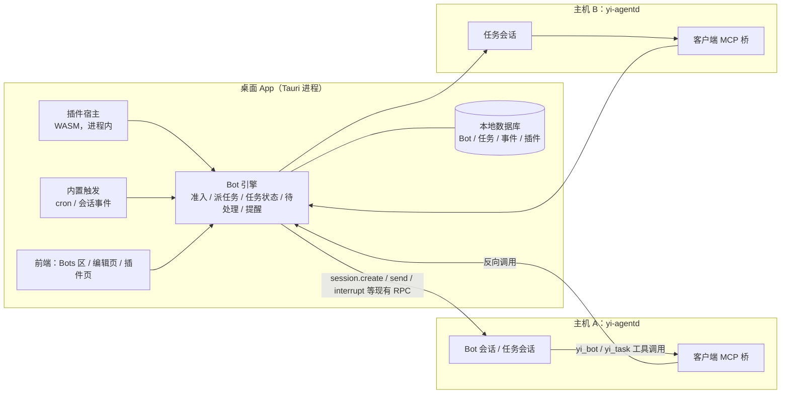
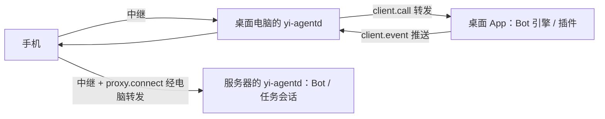
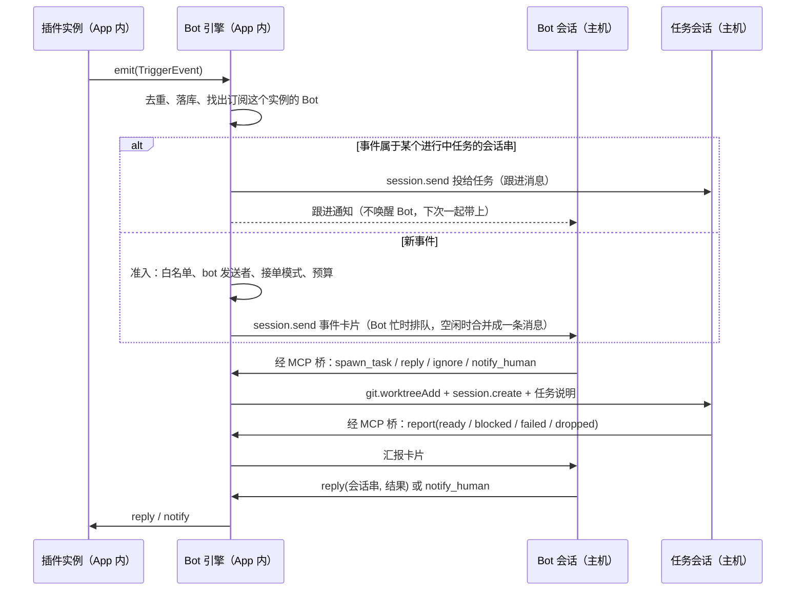

# 方案：Bot 与任务（常驻编排会话 + 插件化触发器）

> 状态：方案草稿，待评审。先用中文；定稿后实现说明写进 `docs/internals/bots.md`（英文），面向用户的说明写进 `docs/guide.md` / `guide.en.md`。
> 参考：DeepSeek [dsh-superagent-prototype](https://github.com/deepseek-ai/dsh-superagent-prototype)（Router/Worker、Ticket、Source 插件、分层提示词），Zed 扩展（WASM），Tauri sidecar（以后接 Node），OpenAI Dots / Claude Duet / Grok Bot / OpenBot（常驻 agent 的产品形态）。

## 1. 目标与非目标

**目标**

- 在**桌面 App** 里可以建多个 **Bot**。Bot 是一个常驻会话，绑定一个 AI 工具，有自己的提示词、触发器、可用工具、工作区（主机 + 目录）和其他配置。
- 触发器产生事件后，Bot 自动处理：它自己回答，或者派出**任务**（新会话）去做，结果回到事件来源。只有需要人时才提醒。
- 侧边栏有单独的 Bots 区，每个 Bot 下面挂它派出的任务。
- 触发器、提醒渠道、工具、提示词片段都通过**插件**扩展。插件可以在 App 内安装和卸载，热生效。当前版本的插件运行时是 **WASM**（加上 Rust 内置插件）；**Node 运行时预留扩展点**，以后通过 Tauri sidecar 接入。
- Bot 可以把任务派到它配置的任意一台已连接主机上。
- 可以通过和 AI 对话来创建、修改 Bot 配置。

**非目标（第一版不做）**

- 在手机端和 yi-web 上**运行** Bot 或插件。它们是桌面端的**遥控器**：能看、能改 Bot 配置、事件、任务、插件，但所有操作都转到桌面端执行（第 3.4 节）。
- 桌面 App 不运行时继续接收触发（这是「全部放在桌面 App」的代价，见第 3.3 节）。
- 插件带自定义前端界面（插件只能用 schema 描述表单）。
- 插件市场和在线检索（第一版支持从文件或 URL 安装）。
- Node 插件运行时。

## 2. 术语

| 中文 | 英文 / 代码 | 含义 |
|---|---|---|
| Bot | `Bot` | 常驻的编排会话及其配置。只负责分派、转达和找人，不直接写代码 |
| 任务 | `Task` | Bot 派出的会话，一个任务对应一个会话（默认带独立 worktree），负责具体干活 |
| 工作区 | `Workspace` | 「主机 + 目录」。Bot 配置一组工作区，任务在其中一个上运行 |
| 插件 | `Plugin` | 一个安装包，提供一种或多种能力（触发器、提醒渠道、工具、提示词片段） |
| 插件实例 | `PluginInstance` | 插件加一份配置，比如同一个飞书插件可以配两个机器人账号。Bot 引用的是实例 |
| 事件 | `TriggerEvent` | 插件实例产生的一条输入，比如 issue 评论、飞书 @、cron 到点 |
| 会话串 | `thread` | 事件所属的对话，比如一个 issue、一条飞书话题。同一会话串的后续消息交给同一个任务 |
| 待处理 | `attention` | 需要人做的事，包括审批、回答问题、确认结果 |

App 里现有的「任务」改名，避免冲突：计划栏 `任务 3/5`、「任务清单」改为「待办」；「后台任务」改为「后台命令」；主页的「子任务」改为「子 agent」。中英文一起改。

## 3. 总体架构

### 3.1 分工



- **桌面 App 负责所有 Bot 逻辑**：Bot 引擎、插件、内置触发、Bot 配置和事件记录。代码放在新 crate `crates/bots`，只有桌面版 Tauri（`app/src-tauri`，非 Android）依赖它。
- **daemon 不知道 Bot 是什么**。Bot 会话和任务会话在主机上仍是普通会话，复用现有的启动、恢复、队列、权限、额度续跑、移交等全部能力。daemon 只补几项**通用能力**（第 3.2 节），桌面 App 用它们实现 Bot。
- **前端调用**：`ClientHub` 增加一个可选的本地服务扩展，由它处理 `bots.*` / `plugins.*` 命令。桌面版注入 `crates/bots` 的实现；Android 和 yi-web 不注入，它们的这些命令经 daemon 转发给桌面端（第 3.4 节）。前端代码是同一套，只是命令的去向不同。
- **事件观察**：Bot 引擎从 `ClientHub` 接收所连主机推来的会话事件（`session.updated`、`session.event`），据此跟踪 Bot 会话和任务的状态。

### 3.2 daemon 需要补的通用能力

| 能力 | 说明 |
|---|---|
| **客户端 MCP 桥** | 会话可以挂一个「由客户端提供」的 MCP 服务器。做法和 `yi_computer_use` 一样：daemon 子命令 `yi-agentd client-mcp --ticket <file>` 作为 stdio MCP，经本地 IPC 连回 daemon，ticket 绑定会话 id，并沿用 `PEER_PID` 绑定。daemon 收到 `tools/list` / `tools/call` 后，转给**创建这个挂载的客户端**（通过一个新的推送事件 `clientMcp.call`），客户端用 `clientMcp.result` 回结果。这是协议里第一个「daemon 调客户端」的方向。客户端不在线或超时时，按挂载时声明的离线策略返回（见第 5.4 节） |
| **客户端标识** | 客户端连上后调用 `client.hello {clientId, kind, name}`，daemon 据此知道哪条连接属于哪个桌面 App（只有本机连接能登记为桌面 App；连远程服务器时登记的身份只用于 MCP 桥回调）。`clientId` 存在桌面 App 的数据目录里，固定不变；`name` 是设备名（比如「办公室台式机」）。`clients.list` 返回当前连着这台 daemon 的桌面端 |
| **转发给桌面端** | `client.call {clientId, cmd, args}`：遥控端（手机、yi-web）调用，daemon 用和 MCP 桥相同的反向通道转给那个桌面端，结果原路返回；桌面端不在线时报「桌面端不在线」。桌面端的推送（`bots.updated` 等）经 `client.event` 发给 daemon，daemon 再推给订阅了这个桌面端的遥控端 |
| **`session.create` 新参数** | `appendSystemPrompt`（追加的系统提示词）、`clientMcp`（要挂的客户端 MCP：名称、clientId、离线策略）、`bot`（归属信息 `BotLink`，存进 `SessionInfo`，让其他客户端也能按 Bot 分组显示） |
| **`session.setClientMcp` / `session.setSystemPrompt`** | 修改已有会话的挂载和提示词；会话空闲时按现有的「MCP 指纹变了就重启工具进程」机制生效 |
| **`git.worktreeAdd` / `git.worktreeRemove`** | 在主机上建 / 删 worktree。路径校验和 `GIT_OPTIONAL_LOCKS=0` 按现有规则来 |
| **设置：worktree 根目录** | `DaemonSettings.worktree_root`，按主机配置，默认 `~/.yi-console/worktrees` |

### 3.3 桌面 App 不运行时

- **托盘**：至少有一个启用的 Bot 时，关闭主窗口只是缩到系统托盘，App 继续运行；没有 Bot 时保持现在的行为。设置里可以关掉。托盘菜单：打开窗口、暂停所有 Bot、退出。
- **App 退出或电脑睡眠时**：Bot 完全停摆，不收外部消息，cron 不触发，Bot 不会被唤醒。
- **错过的 cron 触发直接跳过**，等下一个触发点。
- **已经在跑的任务会继续跑完**（它们是主机上的会话）。任务调用 `report` 等工具时，如果 App 不在线，桥按离线策略回复「已记录，Bot 稍后处理」。App 重新连上主机后，Bot 引擎从任务会话的事件记录里补读这期间的 `yi_task` 调用。调用参数本来就作为 ToolCall 事件存进 daemon 数据库，所以 daemon 不需要另做信箱。
- **外部事件的补收**由插件负责：轮询类插件（GitHub）从上次的读取位置继续；长连接类插件（飞书）重连后能补多少取决于平台，插件在 `prompt.md` 里说明。

### 3.4 手机和 yi-web：桌面端的遥控器

**现有的手机连接方式**（`docs/remote.md`、`docs/internals/remote.md`、`crates/client/src/api.rs`、`crates/yi-agentd/src/proxy.rs`）：

- 手机没有本机主机（`LOCAL_SUPPORTED` 在 Android 上为 false），也不跑 yi-agentd。
- 手机通过**中继**和一台电脑配对：电脑上的 yi-agentd 在中继上登记，桌面 App 里生成一次性配对二维码，手机扫码后保存凭据，主机类型是 `Relay`。手机之后连的是**那台电脑的 yi-agentd**，不是桌面 App。
- 手机访问服务器靠**经电脑转发**：桌面 App 把勾选了「允许已配对的手机经这台电脑访问」（`relay_share`，默认开）的 SSH / 中继主机连同跳板机和 known_hosts，通过 `proxy.setHosts` 同步给本机 yi-agentd（存到 `proxy-hosts.json`，App 关了也在）。手机经 `proxy.list` 发现这些主机，存为 `Proxy` 类型，id 是 `<中继主机 id>~<桌面端的主机 id>`。连接时手机新开一条中继连接，第一条消息 `proxy.connect`，由电脑上的 yi-agentd 去 SSH 目标服务器，之后原样转发 JSON-RPC。
- 所以手机的一切都经过那台电脑的 yi-agentd：电脑关机或睡眠时，手机连不上那台电脑，也连不上经它转发的服务器；只关桌面 App、电脑上的 yi-agentd 还在运行时，手机照常能用会话和转发的服务器。

**遥控 Bot 的做法**：



- 桌面 App 经 `bridge --local` 连着本机 yi-agentd，手机经中继也连着这台 yi-agentd，两者在这里会合，不用新开通道。手机把 `bots.*` / `tasks.*` / `plugins.*` 命令包成 `client.call` 发给这台 yi-agentd，由它转给桌面 App。
- **发现**：手机连上中继主机后调用 `clients.list`，拿到这台电脑上在线的桌面 App，侧边栏显示它的 Bots 区，标题带设备名。服务器的 yi-agentd 不参与转发；经 `proxy.connect` 转发的连接是原样透传，也不会去调 `clients.list`。
- **主机 id 要换算**：Bot 配置和任务里记的是**桌面端的主机 id**，手机上同一台机器的 id 不一样。手机打开 Bot 会话或任务会话时按下面换算：
  - 桌面端的 `local` → 手机上的这个中继主机；
  - 桌面端的其他主机 `X` → 手机上的 `<中继主机 id>~X`（`Proxy` 主机）。
  - 换算不到时（这台主机没勾选「允许已配对的手机经这台电脑访问」），手机上仍能看到任务的状态和汇报（来自桌面端），但打不开会话，界面提示去桌面端打开这台主机的共享。
  - 为此 `bots.*` / `tasks.*` 返回的数据里，主机除了 id 还带上名字和 `relayShare`，方便手机显示和判断。
- **能做的事和桌面端一样**：看和改 Bot 配置、看事件记录、管理任务、管理插件和实例、启停 Bot，以及进入 Bot 会话和任务会话对话、审批。界面复用同一套组件。
- **密钥**：发给手机的仍然是 `********`，保存时 `********` 保留原值，和桌面端一致。
- **安装插件**：手机可以触发安装：给一个 URL，或用现有的 `fs.upload` 把包文件传到桌面电脑上（就是这台 yi-agentd 所在的机器），再让桌面 App 从这个路径安装。权限确认在手机上做，确认结果随命令一起传给桌面 App。
- **桌面 App 不在线时**（电脑开着、yi-agentd 在运行，但 App 退出了）：Bots 区显示「桌面端不在线」，配置和事件看不了；Bot 会话和任务会话所在的主机仍然能连，按 `SessionInfo.bot` 归在对应主机下，可以进入、对话和审批。电脑关机或睡眠时，手机整个连不上，这和现在一样。
- **yi-web**：yi-web 有自己的 `ClientHub` 和主机列表，它连到桌面电脑的 yi-agentd 时（比如 yi-web 就开在这台电脑上，用 local 主机；或者经中继配对），也按同样的方式 `client.call` 遥控；主机 id 的换算规则按它自己的连接方式套用。
- **鉴权**：`client.call` 和其他 RPC 一样，只接受已通过 SSH 桥、中继或本机 IPC 鉴权的连接。daemon 只转发给已 `client.hello` 登记过的桌面 App，并且只接受本机连接（`bridge --local`）做 `client.hello` 登记，防止远程连接冒充桌面端。

## 4. Bot 配置

```jsonc
{
  "id": "bot_8f3a",
  "name": "Issue 小助手",
  "enabled": true,
  "workspaces": [                          // where the Bot and its tasks run; the first one is the default
    { "host": "local", "cwd": "D:/git/yi-console" },
    { "host": "srv-gpu", "cwd": "/data/git/yi-console" }
  ],
  "bot": {                                 // the Bot session itself; any connected host, local or remote
    "host": "srv-gpu", "cwd": "/data/bots/issue-helper",
    "tool": "claude", "model": "sonnet", "effort": "low",
    "permissionMode": "default"            // the Bot reads no code and needs no write access; its own tools are the MCP below
  },
  "task": {                                // defaults for spawned tasks; the Bot may override tool / model / workspace per task
    "tool": "codex", "model": null, "effort": null,
    "permissionMode": "bypass",            // default: allow everything
    "worktree": true,                      // default on: one worktree per task in a git repo; the user can turn it off
    "maxConcurrent": 3,
    "timeoutMinutes": 120
  },
  "triggers": ["pi_feishu_main", "pi_github_repo", "pi_cron_daily"],   // plugin instance ids
  "notify": ["app", "pi_feishu_main"],     // where reminders go: the app plus plugin notify channels
  "mcp": { "bot": [], "task": ["context7"] },  // extra MCP servers from each host's MCP list
  "accept": "observe",                     // off / observe / auto
  "allow": [                               // who may make explicit requests; per plugin instance
    { "instance": "pi_feishu_main", "ids": ["ou_xxx"] },
    { "instance": "pi_github_repo", "ids": ["lidi"] }
  ],
  "budget": { "tasksPerDay": 20 },
  "prompt": { "role": "…", "communication": "…", "delivery": "…" },   // user layer; see section 7
  "promptRevision": 3
}
```

- 新建 Bot 时默认 `accept: observe`，并且不启用。
- **Bot 会话自己的主机和目录单独选**，可以是本机，也可以是任意一台已连接的远程主机；工具和模型从那台主机上已安装的里面选。它和任务的工作区互不相关，比如 Bot 跑在远程服务器上（用那边的 Claude），任务派到本机和另一台服务器。Bot 会话不改代码，目录默认是 `~/.yi-console/bots/<bot-id>`（在 Bot 所在主机上，由 `fs.mkdir` 创建），也可以指定一个仓库目录。
- Bot 会话在远程主机上时，它调用的 `yi_bot` 工具经那台主机的 daemon 的客户端 MCP 桥回到桌面 App。桌面 App 和那台主机断开期间，Bot 的工具调用会失败；Bot 引擎在重新连上后补发断开期间暂存的事件。
- Bot 和任务只能使用支持 MCP 的六个 AI 工具（Claude / Codex / Cursor / Kiro / Qoder / CodeBuddy），并且只能用对话模式。保存时检查每个工作区所在主机是否装了所选工具。
- 配置保存在桌面 App 的本地数据库里（第 10 节），密钥只存在插件实例里。

## 5. 运行流程

### 5.1 事件 → Bot



- **准入**（参照 dsh 的 admission）：
  - 发送者在 `allow` 里，并且明确指向 Bot（@、指派、命令），算**明确请求**。
  - 其他事件算**旁观事件**。只有 Bot 的提示词里写了规则允许时才能接，否则只记录。
  - 发送者是 bot 账号时，**永远**不能直接触发新任务。
  - `observe` 模式下，事件照常交给 Bot 判断，但 `spawn_task` 和 `reply` 只记录「本来会做什么」，不实际执行。
- **合并投递**：Bot 正在处理时，新事件由 Bot 引擎暂存。Bot 这一轮结束后（从 `session.updated` 看到空闲），暂存的事件合并成一条消息发出，每个事件是一张卡片，包含事件 id、来源、会话串、发送者、正文摘要和链接。
- **事件原文**：卡片只放摘要，Bot 和任务需要全文时调用 `read_event` / `read_thread`，由插件的 `readContext` 分页返回。
- **人直接在 Bot 会话里说话**就是「手动触发」，不需要插件：消息直接进 Bot 会话，Bot 照常调用工具派任务。

### 5.2 Bot 会话的上下文

- Bot 是一个长期会话。上下文用量（`context_percent`）超过阈值（默认 70%）时，Bot 引擎在 Bot 空闲时调用现有的 `session.compact`。
- 每个 Bot 有一个持久的备忘，存在 App 本地数据库里，由 Bot 自己通过 `notes_write` 维护：进行中的事、人说过的约束、习惯。压缩后、Bot 会话重启后，备忘内容会附在下一条消息里。
- 任务和事件的状态由 Bot 引擎保存，不依赖 Bot 的记忆。Bot 随时可以调用 `list_tasks` 查询。

### 5.3 任务的生命周期

| 状态 | 含义 | 进入条件 |
|---|---|---|
| `queued` | 等待空位 | 达到 `maxConcurrent` |
| `working` | 进行中 | 会话启动 |
| `needsYou` | 等人 | 任务会话有审批或提问（`SessionInfo.pending`），或者汇报 `blocked` 时带了问题 |
| `ready` | 结果可用，待人看 | 汇报 `ready` |
| `failed` | 失败 | 汇报 `failed`，或者超时 |
| `done` | 结束 | 人标记完成、PR 合并 / 关闭（插件通知），或者汇报 `dropped` |
| `stopped` | 被人停止 | 人在 App 里停止，或者在来源会话串里明确叫停 |

- **每个任务一个会话**，开在 Bot 选定的工作区所在主机上。
- **worktree**：默认（`worktree: true`）且目录是 git 仓库时，为每个任务建一个独立 worktree：`<worktree 根目录>/<仓库名>-<hash>/<task-id>`，分支 `yi/task-<短id>`，任务会话的 `cwd` 就是这个 worktree。
  - 根目录在设置里按主机配置（`DaemonSettings.worktree_root`），默认 `~/.yi-console/worktrees`，在仓库外，不会弄脏仓库目录，也不用改 `.gitignore`。支持 `~` 和绝对路径；改了之后只影响新任务。
  - Bot 配置里可以关掉 worktree，`spawn_task` 也可以对单个任务指定 `worktree: false`。关掉时任务直接在工作区目录里干活，多个任务并行时可能互相覆盖，编辑页会提示。
  - 任务结束后不自动删除 worktree，任务菜单里提供「删除 worktree」。
- **人随时可以接管**：任务就是普通会话页，人直接发消息也会被记录。人工发言之后，这个任务不再接受 Bot 的自动指令，直到人点「交还给 Bot」。
- **人叫停的效果会一直保持**：跟进消息、App 重启、新任务都不会自动恢复（照搬 dsh）。
- **App 重启**：`queued` 的任务按创建顺序重新排队；`working` 的任务读取会话当前状态，并补读离线期间的 `yi_task` 调用（第 3.3 节）。主机 daemon 重启导致的中断沿用现有的 `restart_interrupted` 机制。

### 5.4 Bot 和任务可用的工具（经客户端 MCP 桥）

Bot 会话挂 `yi_bot`，任务会话挂 `yi_task`，两者都由桌面 App 提供，经主机 daemon 的客户端 MCP 桥转发。

**`yi_bot`**（离线策略：返回错误「Bot 所在的桌面 App 不在线」）

| 工具 | 说明 |
|---|---|
| `spawn_task(event_ids[], title, note?, workspace?, tool?, model?, worktree?)` | 开任务。会自动附上原始事件；`note` 最多 30 个词，只能写路由信息，不能写实现方案（dsh 的规则）；`workspace` 从 Bot 配置的工作区里选，默认第一个 |
| `attach(event_id, task_id)` | 把事件交给已有任务 |
| `ignore(event_ids[], reason)` | 不处理，记录原因 |
| `send_task(task_id, text)` | 补充信息（不授予新权限） |
| `task_status(task_id)` / `list_tasks(filter)` | 查询 |
| `stop_task(task_id, reason)` | 停止任务 |
| `reply(event_id, text)` | 回复到事件的会话串（由插件的 `reply` 实现） |
| `notify_human(text, task_id?, urgency)` | 找人：进入待处理，并按 `notify` 配置提醒 |
| `read_event(event_id)` / `read_thread(event_id, cursor?)` | 读原文和上下文 |
| `notes_read()` / `notes_write(text)` | 读写备忘 |
| `save_prompt(section, text)` | 改自己的用户层提示词，生成新版本。**只在人明确要求时使用**，会记录来源 |
| 插件提供的 `tools` | 比如 `github.pr_status` |

**`yi_task`**（离线策略：`report` / `ack` / `handback` 返回「已记录，Bot 稍后处理」，App 上线后从事件记录补读；读取类工具返回错误）

| 工具 | 说明 |
|---|---|
| `report(state, summary, question?, links[])` | `progress` / `ready` / `blocked` / `failed` / `dropped`；`question` 进入待处理 |
| `ack(event_id, text)` | 开工前确认一次（「正在把设置页的保存按钮改成…」），由 Bot 引擎经插件回到会话串 |
| `handback(event_id, reason)` | 跟进消息超出本任务范围时，交还给 Bot |
| `read_event` / `read_thread` | 同上 |
| 插件提供的 `tools` | 同上 |

任务里**没有**直接给人发消息的工具，只能通过 `report` 交给 Bot 转达，这样同一个会话串里只有一个声音。

## 6. 人介入与提醒

- **进入待处理的情况**：任务会话有审批或提问；任务汇报 `blocked` 或 `failed`；Bot 调用 `notify_human`；任务超时；超出预算。其他情况一律静默。
- **App 内**：侧边栏 Bot 行显示待处理角标；有待处理时发系统通知（复用现有的通知偏好和 `systemNotify`），点击跳到对应任务或 Bot。
- **插件提醒渠道**：Bot 配置的 `notify` 里列出的插件实例（比如飞书私信）。手机不在 App 里也能收到。
- **手机端**：桌面端在线时，手机看到的待处理角标和桌面端一样（经 `client.event` 推送）。任务会话和 Bot 会话在主机上，手机照常能处理它们的审批和提问。系统通知仍由桌面端发；要在手机上收到提醒，配置插件提醒渠道（比如飞书私信）。

### 6.1 例行任务、先起草再批准、费用护栏（2026-11-10 新增）

参考 Grok 的 Routines 和审批、OpenClaw 的定时任务做的三项，都在对话里设置，详情页只读展示。

- **例行任务**：Bot 配置里的 `routines`（名称、5 段 cron、要做的事、是否启用）。到点时引擎把这件事作为一条消息交给 Bot，并记一条运行记录（每个例行任务保留最近 20 条）。Bot 做完用 `routine_done` 收尾：没有新内容就记「无新内容」、不打扰人；有结果写一两句摘要；失败写原因。没收尾的，Bot 这一轮结束时算完成。App 关着时错过的不补跑；上一次还没结束时，这一次记为跳过。详情页可以「立即运行」并查看运行记录。例行任务不受活跃时段限制。
- **先起草再批准**：`approval {reply, write}`，新建的 Bot 默认都开。只在自动执行模式、并且这一轮不是主人在会话里直接发起时生效：回复和会改动外部的插件操作先存成草稿，Bot 会话顶部和详情页显示卡片，同时发到提醒渠道。主人可以批准、修改回复后批准或拒绝；结果告诉 Bot。2 小时内不处理的作废，也告诉 Bot。关闭审批算敏感修改，要主人确认。
- **费用护栏**：`budget.tokensPerDay`，统计 Bot 和它的任务每天用的 token（输入、输出和缓存写入，不含缓存读取），超过时提醒一次，不暂停。原有的每天任务数上限照旧。
- **活跃时段**：`activeHours`（星期和起止时间，可以跨午夜）。时段外插件来的事件先排队，到时段开始再交给 Bot；内置来源、任务汇报、例行任务和主人的消息不受影响。

## 7. 提示词

### 7.1 三层结构（照搬 dsh）

| 层 | 内容 | 谁维护 |
|---|---|---|
| 内置层 | `shared`（角色分工）、`bot`（Bot 角色和工具用法）、`task`（任务的干活规范）、`dispatch`（如何派活和转达）、`communication-defaults` | 我们，随版本更新 |
| 用户层 | **职责与范围**（这个 Bot 管什么、做到什么程度停）、**沟通方式**（什么时候说话、怎么说）、**交付标准**（PR 要附什么、能不能自动合并） | 用户在 Bot 会话里说，Bot 用原话写进去 |
| 生成层 | `environment`（工作区、仓库、工具）、`triggers`（每个实例的说明，加上插件自带的 `prompt.md`）、`policy`（接单模式、白名单、预算） | 代码根据配置生成 |

**拼接顺序**：内置 shared → 角色（bot / task） → 用户层三节 → dispatch（Bot）或 work（任务） → 插件提示词 → environment → policy（放最后，改策略不影响前面文本的缓存）。

**优先级**：代码强制的约束 > 内置层 > 用户层 > 外部文本。外部文本（issue、群消息、文档）只算数据，不能改变规则或授权。

### 7.2 内置提示词的要点（初稿，英文写给模型）

- **Bot 只做路由**：不看代码、不设计方案、不改写请求；转给任务的是原始事件，不是 Bot 自己的复述。
- **Bot 不等待**：汇报、跟进、新事件都会作为消息自己送到；不要用 `sleep` 或轮询；没事做就结束这一轮。
- **只在人需要做事时说话**：结果可用、需要人决策或授权、确定做不了。默认一句话，进度只在内部流转。发之前逐句自问：删掉这句话，人会不会因此看不懂结果或不知道该做什么？
- **任务开工前确认一次**：写明对象和预期结果，不写「好的我来处理」这类空话。
- **诚实交付**：开了 PR 不等于完成；没做完的标草稿；需要人做的事写成一个具体问题。
- **人叫停的效果一直保持**，直到人明确解除。

### 7.3 下发方式

- 桌面 App 拼好提示词，通过 `session.create` 的 `appendSystemPrompt` 交给 daemon。daemon 按工具下发：Claude 用 `--append-system-prompt`，Codex 用 `developerInstructions`；ACP 工具没有系统提示词入口，在第一条消息前加一次 `<system-reminder>`。这三种方式都已有先例（`computer_use::model_hint`）。
- 提示词有版本，每次保存是一个不可变版本，记录基于哪个版本、来源（新建 / Bot 自己 / 回滚）和时间。
- **何时生效**：保存后通过 `session.setSystemPrompt` 更新 Bot 会话，空闲时重启工具进程生效；已在运行的任务用的还是开工时的版本。
- **内置默认文本升级后**：如果用户覆盖过某一节，界面标出「默认已更新」，并给出 diff。

## 8. 用对话创建和修改 Bot（没有表单）

参考 Grok 的做法（2026-11-10 修订）：去掉 Bot 表单和单独的配置助手，Bot 自己在对话里引导设置。

- **新建**：侧边栏 Bots 区的「+」打开新建会话页的 Bot 模式。和新建普通会话一样选主机、目录、工具、权限模式和模型（只能是 AI 工具、只能是对话模式），第一条消息写这个 Bot 负责什么。其余都用默认值：名字取自角色开头，工作区就是所选目录，任务用同一个工具和模型，只观察（observe），通知到 App。
- **引导**：还没接消息来源时，Bot 的提示词里有一段「开始」：先用一句话确认职责、给自己起个短名字，再用一个简短清单问消息来源、通知方式和是否自动执行；没回答的项保持默认。
- **修改**：Bot 有这些工具：

| 工具 | 说明 |
|---|---|
| `get_config()` | 当前配置 |
| `update_config(changes, instances?, reason)` | 按 JSON merge patch 修改配置，可以顺带新建插件配置（不含密钥） |
| `list_hosts()` / `list_tools(host)` / `list_models(host, tool)` | 可用的主机、工具和模型 |
| `list_plugins()` / `list_instances()` | 已安装插件（能力、参数 schema）和已有插件配置（密钥显示为 `********`） |
| `propose_plugin(task_id, path)` | 提交任务写好的插件，等人确认安装 |

- **只听主人的**：只有主人在 Bot 会话里直接说的话才能触发修改；事件或任务汇报引起的轮次里，`update_config` 会被拒绝。
- **敏感项要确认**：改成自动执行、修改允许名单、修改权限模式时，修改先挂起，会话顶部出现确认卡片，主人点确认才生效。
- AI **看不到密钥**。密钥存在插件配置里，Bot 只是选用哪几份插件配置。缺密钥的插件配置先停用，Bot 会话里出现安全输入卡片，值直接写进插件配置，AI 看不到；填好后自动启用。Bot 需要更换某个密钥时，用 `request_secret` 请主人在卡片里重新填写。
- **详情页**只读：显示当前设置、提示词和修订记录（可以回滚）、笔记、统计和事件，可以暂停、启用和删除。
- **写插件**归 Bot 管，但 Bot 不自己写：它派一个任务去写（任务有 `plugin_kit` 工具），任务做完后 Bot 检查结果和权限，再用 `propose_plugin` 提交，人确认后安装。

## 9. 插件系统

插件只在桌面 App 里运行。

### 9.1 插件包

```text
feishu-1.2.0.yiplugin          (zip)
├── plugin.json
├── plugin.wasm                (runtime = wasm: a WASI 0.2 component)
│   (reserved: dist/main.js for runtime = node)
├── prompt.md                  (optional: how to handle this source's events, joins the generated layer)
├── locales/zh.json, en.json   (optional: labels in the config schema)
└── LICENSE
```

```jsonc
{
  "id": "feishu",                       // globally unique, [a-z0-9-]
  "version": "1.2.0",
  "api": "0.1",                         // yi:plugin interface version
  "runtime": "wasm",                    // wasm now; node reserved (rejected at install until supported)
  "main": "plugin.wasm",
  "name": { "zh": "飞书", "en": "Feishu" },
  "description": { "zh": "接收飞书机器人的群聊和私聊消息，并回复到原会话", "en": "…" },
  "capabilities": ["trigger", "reply", "context", "notify", "tools"],
  "permissions": {
    "net": ["open.feishu.cn", "*.feishu.cn"],   // outbound hosts allowed
    "exec": []                                   // local commands allowed on the desktop machine (e.g. "gh")
  },
  "config": {                           // JSON Schema plus x-ui hints; drives the form, AI validation and redaction
    "type": "object",
    "required": ["appId", "appSecret"],
    "properties": {
      "appId": { "type": "string", "title": "App ID" },
      "appSecret": { "type": "string", "title": "App Secret", "x-secret": true },
      "chats": { "type": "array", "title": "监听的群", "items": { "type": "string" }, "x-ui": "rows" },
      "listen": { "enum": ["mentions", "all"], "default": "mentions" }
    }
  }
}
```

- `runtime` 字段从第一版就有，当前只接受 `wasm`。遇到 `node` 时报「当前版本不支持 Node 插件」，不会当成错误格式。
- `x-secret` 字段明文保存（和 MCP 的 env / headers 一样），发给前端和 AI 时替换成 `********`；保存时如果回来的值还是 `********`，就保留原值。

### 9.2 统一接口 `yi:plugin`（WIT 草案）

```wit
package yi:plugin@0.1.0;

interface types {
  record sender { id: string, name: option<string>, bot: bool }
  record trigger-event {
    key: string,                 // source-side id, used to dedup
    thread: string,              // conversation key (e.g. "github:owner/repo#12", "feishu:oc_x:om_root")
    sender: sender,
    addressed: bool,             // explicitly addressed to the agent: @ / assigned / command
    text: string,
    url: option<string>,
    at: u64,
    attachments: list<attachment>,
    meta: string,                // JSON, plugin specific
  }
  record attachment { name: string, mime: string, ref: string }
  record context-page { messages: list<context-message>, next: option<string> }
  record context-message { id: string, sender: sender, at: u64, text: string, url: option<string> }
  record tool-def { name: string, description: string, input-schema: string }
  variant send-result { sent, gone }   // gone: the conversation no longer accepts replies
}

// What the host gives a plugin
interface host {
  use types.{trigger-event};
  config: func() -> string;                          // JSON, secrets included
  emit: func(event: trigger-event);
  kv-get: func(key: string) -> option<string>;
  kv-set: func(key: string, value: option<string>);
  log: func(level: string, message: string);
  health: func(state: string, detail: string);       // ok / starting / error
  http-fetch: func(req: string) -> result<string, string>;   // JSON request / response, host checks permissions.net
  ws-open: func(url: string, headers: string) -> result<u32, string>;
  ws-send: func(id: u32, data: list<u8>) -> result<_, string>;
  ws-close: func(id: u32);
  exec: func(cmd: string, args: list<string>, stdin: option<string>) -> result<string, string>;  // checks permissions.exec
  set-timer: func(ms: u64, repeat: bool) -> u32;
  clear-timer: func(id: u32);
}

// What a plugin implements; every capability is optional and declared in plugin.json
interface plugin {
  use types.{send-result, context-page, tool-def};
  start: func() -> result<_, string>;
  stop: func();
  on-timer: func(id: u32);
  on-ws: func(id: u32, kind: string, data: list<u8>);
  reply: func(thread: string, reply-to: option<string>, key: string, text: string) -> result<send-result, string>;
  notify: func(text: string, key: string) -> result<send-result, string>;
  read-context: func(thread: string, cursor: option<string>) -> result<context-page, string>;
  tools: func() -> list<tool-def>;
  call-tool: func(name: string, input: string) -> result<string, string>;
}

world yi-plugin { import host; export plugin; }
```

- `reply` / `notify` 带 `key` 作为幂等键（dsh 也这样做）：重试时插件要保证不重复发送。
- 接口按版本号管理，参照 Zed 的 `since_v0_x`：App 同时支持几个旧版本，旧插件在新版本上能继续运行。

### 9.3 运行时

- 插件管理器通过 `PluginRuntime` trait 调用运行时：`load(manifest, bytes) / start(instance) / stop(instance) / call(instance, method, args) / unload`。当前实现 `builtin`（Rust）和 `wasm` 两种。
- **WASM**：wasmtime + Component Model，直接实现上面的 WIT world。插件一般用 Rust 写（`cargo component` / `wasm32-wasip2`），SDK crate `yi-plugin` 提供 WIT 绑定、事件和 schema 辅助、本地测试桩。
  - 用 epoch 中断限制单次调用时长（默认 5s），并限制内存上限（默认 64MB）。插件 trap 时只停掉这个插件，标记为不健康；连续失败时退避重启（1s → 30s）。
  - 网络、WebSocket、命令都只能通过 `host` 接口访问，并按 `permissions` 检查；不给 WASI 的文件和网络权限。
  - 热插拔：安装、升级、停用时只销毁或重新实例化这一个插件，先调用它的 `stop`。
  - 体积：wasmtime 只打包进桌面 App，daemon 不受影响。
- **Node（预留）**：以后作为第三种 `PluginRuntime` 接入，形态是 Tauri sidecar 起一个共享的 Node 插件宿主进程，所有 Node 插件都在里面运行，cordis 式的 `apply(ctx, config)` + `ctx.effect` 热插拔，和宿主之间用 JSON-RPC 实现同一份 WIT 接口。Node 不是沙箱，安装时要明确提示。

### 9.4 内置插件（Rust，走同一套接口）

| 插件 | 能力 | 说明 |
|---|---|---|
| `cron` | trigger | cron 表达式加一段固定文本，比如每天 9 点「整理昨天的 issue」。App 没运行时错过的触发点直接跳过 |
| `session-events` | trigger | 任意已连接主机上的某个会话结束、出错、等待审批时触发，比如让 Bot 盯着其他会话 |
| `app-notify` | notify | App 内系统通知 |

手动触发不需要插件：人直接在 Bot 会话里说话即可。

**第一批外部插件**（第二期，WASM，用 Rust 写，同时作为插件 SDK 的示例）：`github`（经 `http-fetch` 调 REST API 轮询通知、评论、PR、CI，并回帖）、`feishu`（经 `ws-*` 建立长连接收消息，经 `http-fetch` 回复）。

### 9.5 安装与管理

- 入口：设置 → 插件（仅桌面 App）。
- 来源：本地文件（`.yiplugin`）或 URL。
- 安装时展示插件的能力和权限（访问哪些域名、能在这台电脑上执行哪些命令），由用户确认。升级时如果权限变多，需要重新确认。
- 支持启用、停用、升级、卸载，全部热生效。卸载时可以选择是否保留它的 kv 数据。
- 插件实例：在插件详情页新建实例、填写配置，然后在 Bot 配置里引用。每个实例都显示健康状态和最近的错误。

## 10. 数据

**桌面 App 本地数据库**（新文件 `<app_data_dir>/bots.db`，SQLite）

| 表 | 主要列 |
|---|---|
| `bots` | `id`、`config`（JSON）、`notes`、`session`（主机 id + 会话 id）、`created_at`、`updated_at` |
| `bot_prompts` | `bot_id`、`revision`、`base_revision`、`sections`（JSON）、`origin`、`at` |
| `plugins` | `id`、`version`、`manifest`（JSON）、`enabled`、`installed_at`（包文件解压在 `<app_data_dir>/plugins/<id>/<version>/`） |
| `plugin_instances` | `id`、`plugin_id`、`config`（JSON，密钥明文）、`enabled` |
| `plugin_kv` | `instance_id`、`key`、`value` |
| `trigger_events` | `id`、`instance_id`、`key`（唯一）、`thread`、`sender`、`addressed`、`text`、`meta`、`at`、`disposition`（`filtered` / `observed` / `queued` / `delivered` / `attached` / `ignored`）、`bot_id`、`task_id` |
| `tasks` | `id`、`bot_id`、`host`、`session_id`、`state`、`title`、`event_ids`、`threads`、`worktree`、`last_report`、`hold`（人叫停）、`seen_seq`（补读 `yi_task` 调用的位置）、`created_at`、`ended_at` |
| `outbox` | 待发送的 `reply` / `notify`：`id`（幂等键）、`instance_id`、`payload`、`attempts`、`next_at` |

**daemon 侧**：不新增表。`SessionInfo` 新增字段：

```rust
/// Set by a desktop client on the Bot's own session and on its tasks; absent for ordinary sessions
#[serde(default, skip_serializing_if = "Option::is_none")]
pub bot: Option<BotLink>,
/// MCP servers served by a client through the client MCP bridge
#[serde(default, skip_serializing_if = "Vec::is_empty")]
pub client_mcp: Vec<ClientMcp>,
/// Extra system prompt given at creation; delivered per tool like the computer-use hint
#[serde(default, skip_serializing_if = "Option::is_none")]
pub append_system_prompt: Option<String>,

pub struct BotLink { pub bot_id: String, pub bot_name: String, pub role: BotRole /* bot / task */, pub task_id: Option<String>, pub client_id: String }
pub struct ClientMcp { pub name: String, pub client_id: String, pub offline: OfflinePolicy /* error / accept */ }
```

`task_state` 不存在 daemon 里，由桌面 App 维护；手机端经 `client.call` 向桌面端查询。

## 11. 接口

**daemon 新方法**（先在 `crates/proto` 的 `methods` 里加常量，再在 `server.rs` 里分派，最后在 `ClientHub::call` 中暴露；前端类型在 `app/src/types.ts` 里手工同步）

| 方法 / 事件 | 说明 |
|---|---|
| `client.hello` | 客户端报告 `clientId` 和类型 |
| `session.create` 新参数 | `appendSystemPrompt`、`clientMcp`、`bot` |
| `session.setClientMcp` / `session.setSystemPrompt` | 修改已有会话 |
| 推送 `clientMcp.call` / 方法 `clientMcp.result` | 客户端 MCP 桥的反向调用 |
| `clients.list` | 当前连着这台 daemon 的桌面端 |
| `client.call` / `client.event` | 遥控端经 daemon 调用桌面端命令；桌面端推送状态给遥控端 |
| `git.worktreeAdd` / `git.worktreeRemove` | worktree 管理 |
| 设置 `worktreeRoot` | 在现有 `settings.get` / `settings.set` 里 |

**桌面 App 本地命令**（`ClientHub` 的本地服务扩展，由 `crates/bots` 实现）

| 命令 | 说明 |
|---|---|
| `bots.list` / `bots.get` / `bots.save` / `bots.delete` / `bots.setEnabled` | Bot 增删改查、启停 |
| `bots.prompts` / `bots.promptRestore` | 提示词版本、回滚 |
| `bots.events` | 事件记录（分页、按状态过滤），用来检查 observe 模式下「本来会做什么」 |
| `tasks.list` / `tasks.stop` / `tasks.retry` / `tasks.markDone` / `tasks.handBack` / `tasks.removeWorktree` | 任务操作 |
| `plugins.list` / `plugins.install` / `plugins.uninstall` / `plugins.setEnabled` | 插件管理 |
| `plugins.instances` / `plugins.saveInstance` / `plugins.deleteInstance` | 插件实例 |
| 本地推送 `bots.updated` / `tasks.updated` / `plugins.updated` | 状态变化 |

所有错误信息用中文，由 `i18n.ts` 翻译（沿用现有规则）。

## 12. 前端

- **侧边栏**：顶部（在主机列表之上）是「Bots」区，只在桌面 App 且至少有一个 Bot 时显示。Bot 可以跨主机派任务，所以 Bots 区不放在某个主机块里。
  - Bot 一行显示状态点（运行 / 空闲 / 停用 / 出错 / App 离线）、待处理角标和名字。菜单里有编辑、启用 / 停用、事件记录和删除。
  - 展开后是任务列表：进行中和待处理的排在前面，已结束的折叠到「更早」里；每个任务显示所在主机。
  - Bot 会话和任务会话**不出现在主机下的普通会话列表里**（按 `SessionInfo.bot` 过滤，和现在的 `parentId` 一样）。
- **手机端和 yi-web**：功能和桌面端一样，命令经 `client.call` 转给桌面端。侧边栏为每个在线的桌面端显示一个 Bots 区（标题带设备名）；桌面端离线时显示「桌面端不在线」，Bot 会话和任务会话按 `SessionInfo.bot` 归在所在主机下，仍可进入。
- **Bot 页面**：就是 Bot 会话的会话页，顶部多一条：配置、事件记录、任务看板。
- **任务页面**：普通会话页，顶部显示所属 Bot、状态、来源事件链接，以及「交还给 Bot」「标记完成」「停止」「删除 worktree」。
- **Bot 编辑页**：基本信息、工作区（主机 + 目录，可多个）、Bot 会话、任务默认值、触发器、提醒、准入、预算、提示词（三节加版本历史）。也可以从「和 AI 一起创建」得到的草稿进入。
- **插件页**：设置 → 插件，包括列表、安装、权限确认、实例配置（由 schema 生成表单）和健康状态。
- **设置**：「关闭窗口后缩到托盘」开关；每台主机的 worktree 根目录。
- **总览看板**：增加按 Bot 分组的视图，待处理的排在最前。
- 所有覆盖页面的组件都注册 `useBack`；新文案中英文都要加；不用 `confirm` / `prompt`。

## 13. 安全

- **任务默认 bypass**：等于任何能触发 Bot 的人都可以借任务在工作区主机上以你的身份执行命令。防线：
  1. 白名单：只有白名单里的人能发明确请求。
  2. bot 账号发的消息永远不能直接开任务。
  3. 新建 Bot 默认是 observe 模式。
  4. 外部文本在提示词里明确定义为数据，不能改变规则。
  5. 每日预算。
  6. worktree 隔离（只防误改，不防恶意）。
- **客户端 MCP 桥**：daemon 只把调用转给挂载时登记的那个 `clientId` 的连接；ticket 和 `PEER_PID` 绑定和 `yi_computer_use` 一样，防止模型自己另开 MCP 客户端调用。
- **遥控转发**：`client.call` 只接受已鉴权的连接，只转给已登记的桌面端；AI 工具进程（经 MCP 桥）不能调用 `client.call`，避免模型绕过工具直接改 Bot 配置。
- **插件**：当前只有 WASM 插件，是沙箱，只能用 `permissions` 里声明并经用户确认的域名和命令。`exec` 在**桌面电脑**上执行，权限本身很大（比如允许 `gh` 就能操作你的 GitHub），安装时单独高亮。
- **密钥**：只保存在桌面 App 本地，不进入提示词，也不给 AI 看。
- **不新开端口**：所有触发器都用轮询或长连接。

## 14. 分期

| 期 | 内容 | 完成后能做什么 |
|---|---|---|
| P1 Bot 核心 | daemon：`client.hello`、客户端 MCP 桥、`session.create` 新参数、worktree 方法和根目录设置。App：`crates/bots`、本地数据库、Bot 引擎、`yi_bot` / `yi_task`、三层提示词、内置 `cron` / `session-events` / `app-notify`、托盘、Bots 区、Bot 编辑页、任务页顶栏；「任务」改名 | 在 App 里和 Bot 对话或用 cron 触发，自动派任务（可跨主机），需要人时提醒 |
| P2 WASM 插件 | 插件管理器、`PluginRuntime` trait、`plugin.json`、安装和权限确认、wasmtime 运行时和资源限制、`yi-plugin` SDK crate；`github`、`feishu` 两个插件；`reply` / `readContext` / `notify`、`outbox` | 可以安装插件，从 GitHub 和飞书触发，结果回到原会话 |
| P3 遥控与体验完善 | `clients.list` / `client.call` / `client.event`、手机和 yi-web 的 Bots 区；总览看板的 Bot 视图、事件记录页、提示词版本 diff、预算统计 | 在手机上看和管理桌面端的 Bot、事件、插件 |
| P4 AI 辅助 | 新建页的 Bot 模式、Bot 在对话里改自己的配置（敏感项要确认）、任务写插件 | 用对话创建和修改 Bot 及插件 |
| P5 例行与护栏 | 例行任务和运行记录、先起草再批准、每日 token 提醒、活跃时段（§6.1） | 让 Bot 定时做事，对外操作先过目，费用心里有数 |
| 以后 | Node 插件运行时（Tauri sidecar）、插件市场、插件自定义界面 | |

每一期都要补测试：Bot 引擎和准入逻辑的单元测试；客户端 MCP 桥的单元测试（转发、离线策略、`clientId` 校验）；用假的插件实例跑端到端测试（`YI_CONSOLE_HOME` 隔离）。按记忆里的约定，编译和测试在 Windows 上跑。

## 15. 已确认与待确认

已确认（2026-11-09）：

- 常驻会话叫 Bot，派出的会话叫任务；App 里原有的「任务」改名。
- **Bot 引擎、插件、内置触发全部放在桌面 App 里**；只有桌面 App 运行它们。daemon 只补通用能力。
- **手机和 yi-web 是桌面端的遥控器**：能看、能改 Bot 配置、事件、任务、插件，命令经桌面电脑上的 daemon 转给桌面端。
- 至少有一个启用的 Bot 时，关闭窗口默认缩到托盘，可在设置里关掉。
- App 没运行时错过的 cron 触发点直接跳过。
- Bot 配置一组允许的工作区（主机 + 目录），任务可以派到其中任意一个。
- Bot 会话自己的主机单独选，本机或任意已连接的远程主机都可以。
- 手机经中继和桌面电脑配对，访问服务器靠桌面电脑的 yi-agentd 转发（`Proxy` 主机）。遥控 Bot 只经桌面电脑本机的 yi-agentd 转发；服务器的 yi-agentd 不参与。手机上的主机 id 和桌面端不同，打开会话时要换算（第 3.4 节）。
- 当前版本不支持 Node 插件，只预留扩展点；插件运行时先做 WASM 和 Rust 内置。
- 插件密钥和 MCP 一样明文保存，对外显示时替换成 `********`。
- 任务默认开独立 worktree，用户可以在 Bot 配置里关掉，也可以对单个任务关掉；worktree 根目录在设置里按主机自定义。
- 方案文档先用中文，放在 `docs/proposals/bots.md`。

待确认：暂无。
