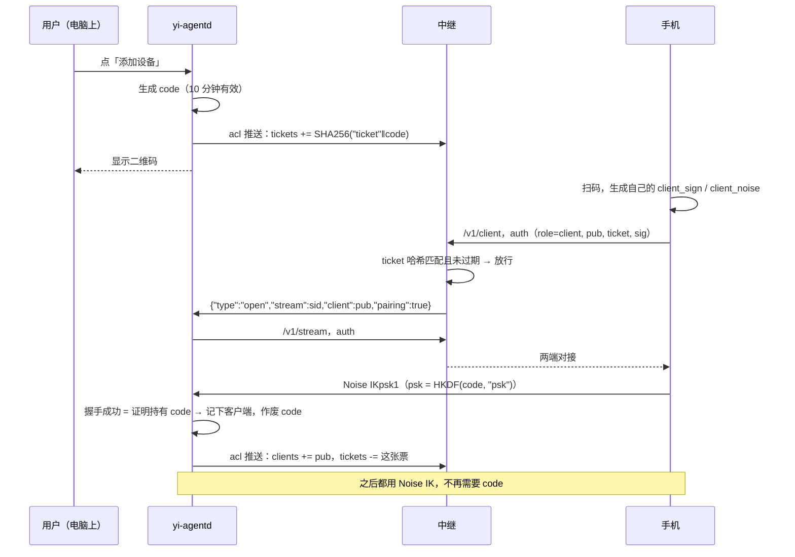

# 中继鉴权与端到端加密 v2 方案

状态：已实现　｜　日期：2026-11-02　｜　不兼容旧版本，升级后所有设备需要重新配对

## 1. 为什么要改

v1 的做法（`crates/link/src/lib.rs`、`crates/relay/src/main.rs`）：

| 层 | v1 用的凭证 | 问题 |
|---|---|---|
| 连中继 | 一个所有人共用的 `--token` | 写在每份配对链接里，没法只吊销某一台设备；没配置时谁都能用 |
| yi-agentd 在中继上的身份 | 设备 id + `device_token`，首次连接时记下（TOFU） | 每次连接都把令牌原样发给中继 |
| 客户端在中继上的身份 | 无（只有共用令牌 + 设备 id） | 拿到令牌和设备 id 的人可以反复请求开数据流，占满设备 32 个名额 |
| 端到端 | 所有客户端共享一个配对密钥 K，用 HMAC 做双向挑战，再派生 ChaCha20-Poly1305 密钥 | 没有前向保密：K 一旦泄露，之前录下的流量都能解密；无法单独吊销某个客户端 |
| 传输 | `token`、`auth`、`stream` 放在 URL query 里 | 会被反向代理写进访问日志 |

v2 的目标：

1. URL 里不放任何密钥（v1 问题第 5 行）。
2. 中继在对接两端之前，先确认客户端是这台设备授权过的（问题第 3 行）。
3. 设备和客户端都用公钥做身份，中继只保存公钥，不保存任何能直接拿来用的密钥（问题第 2 行）。
4. 每个客户端有自己的密钥，可以单独吊销；配对二维码里不再放长期密钥；端到端握手提供前向保密（问题第 1、4 行）。

## 2. 总体设计

### 2.1 角色与密钥

| 谁 | 密钥 | 用途 | 存在哪 |
|---|---|---|---|
| yi-agentd（设备） | Ed25519 签名密钥 `agent_sign` | 向中继证明自己是这台设备 | `relay.json`（0600） |
| yi-agentd | X25519 静态密钥 `agent_noise` | 端到端 Noise 握手，客户端靠它的公钥识别设备 | `relay.json` |
| 每个客户端 | Ed25519 签名密钥 `client_sign` | 向中继证明自己是某个已授权的客户端 | 客户端的主机配置（`HostConfig.pairing`，界面上隐藏） |
| 每个客户端 | X25519 静态密钥 `client_noise` | 端到端 Noise 握手，yi-agentd 靠它识别客户端 | 同上 |
| 中继运营者 | 一次性邀请码 `invite`（取代固定的 `--token`） | 让一台新电脑在中继上登记自己的公钥，用完或过期即作废，**客户端不需要它** | 中继只存哈希（`relay-invites.json`）；yi-agentd 用完即丢 |
| 中继 | 已登记设备列表（设备公钥） | 判断哪些 yi-agentd 可以挂到这个中继上，可以单独吊销 | `relay-devices.json`（只有公钥） |
| 中继 | TLS 证书 | 传输层加密；自签名时客户端按指纹固定 | 中继数据目录 |
| 临时 | 一次性配对码 `code`（32 字节） | 新客户端第一次配对时用，10 分钟有效，用过即作废 | 只在 yi-agentd 内存里和二维码里 |

签名用 Ed25519，加密用 X25519，按惯例分成两对密钥，不做互相转换。

**设备 id 由公钥算出来**：`device = hex(SHA-256(agent_sign 公钥)[0..16])`。中继拿到公钥后自己算一遍就能确认设备 id 属于谁，不再需要 v1 那种“谁先注册谁占用”（TOFU）的令牌注册表。`relay-devices.json` 保留，但内容改为经邀请登记过的设备公钥（见 3.3）。客户端 id 也一样：`client_id = hex(SHA-256(client_sign 公钥)[0..8])`。

### 2.2 两层鉴权各管什么

```
 客户端 ──TLS──▶ 中继 ◀──TLS── yi-agentd
   │   ①中继层鉴权：挑战-签名，  │
   │     中继按设备推来的白名单判断 │
   │                            │
   └────── ②端到端 Noise IK ─────┘
          中继只转发密文
```

- **① 中继层**：决定“能不能让你通过中继”。中继验证签名、核对白名单，**看不到**消息内容。
- **② 端到端**：决定“能不能和这台设备说话”，同时负责加密。即使中继被攻破、白名单被篡改，没有正确的 Noise 密钥也连不上 yi-agentd。

两层互相独立。① 主要防滥用和资源耗尽，② 保证安全。

## 3. 中继层鉴权（对应改进 1、2、3）

### 3.1 URL 里不再放密钥

三个端点 `/v1/agent`、`/v1/client`、`/v1/stream` 的 URL 不带任何参数。WebSocket 升级完成后，**第一组消息就是鉴权**：

```
中继 → 对端   {"type":"challenge","v":2,"nonce":"<32 字节随机数, b64>"}
对端 → 中继   {"type":"auth", ...见下表... , "sig":"<Ed25519 签名, b64>"}
中继 → 对端   {"type":"ok"}             或关闭连接（4401 未授权 / 4403 被拒 / 4004 设备不在线）
```

被签名的内容（各字段按长度前缀拼接，防止歧义）：

```
"yi-console relay auth v2" ‖ role ‖ device ‖ stream ‖ nonce
```

| role | 端点 | auth 消息里的字段 | 中继怎么判断 |
|---|---|---|---|
| `agent` | `/v1/agent` | `device`、`pub`（agent_sign 公钥）、`sig`；首次登记时另带 `invite` | 设备 id 等于 hash(pub)；签名有效；pub 在已登记设备列表里，或者 `invite` 有效（此时完成登记，见 3.3） |
| `stream` | `/v1/stream` | `device`、`pub`、`stream`（中继下发的数据流 id）、`sig` | 设备已登记、签名有效，并且 `stream` 必须是这台设备正在等的数据流 |
| `client` | `/v1/client` | `device`、`pub`（client_sign 公钥）、`sig`；首次配对时另带 `ticket` | 签名有效，**并且** pub 在该设备的客户端白名单里，或者 `ticket` 在该设备的有效配对票据里 |

为什么用握手后的消息，而不是 HTTP 头：

- 不会出现在 URL、Referer 或反向代理的访问日志里（大部分代理默认只记录请求行，但很多人会顺手把头也记下来）。
- 中继每次连接都发一个新随机数，签名只对这一次连接有效，被截获也不能重放。
- 浏览器和 Android 的 WebSocket API 对自定义头支持不一，放在消息里各端实现都一样。

鉴权单独限时 10 秒。失败分两类：签名错、格式错、超时、猜错邀请码或配对票据，**计入该 IP 的失败次数**（`Limits::record_fail`），连续失败会被拉黑；身份已经证明、只是没有权限的（被移除的设备、未登记的电脑、设备离线）**不计入**。被移除的设备会自动重连，它常和其他设备在同一个 NAT 后面，计入的话会把同一 IP 下的设备一起拉黑（端到端测试里实际遇到过）。客户端遇到这类拒绝也会停止自动重连。

### 3.2 中继上的客户端白名单（ACL）

yi-agentd 通过已经鉴权过的控制连接，把这台设备的白名单推给中继：

```json
{"type":"acl",
 "clients":["<client_sign 公钥 b64>", "..."],
 "tickets":[{"hash":"<b64>","exp":1762070400}]}
```

- 控制连接每次建立时推一次全量；配对、吊销、配对码过期时再推一次全量。
- 中继**只放在内存里**，不写盘。设备离线时客户端本来就连不上；中继重启后 yi-agentd 会重连并重新推送。
- 中继收到新的 ACL 后，**立即断开**已经不在名单里的客户端的数据流（中继记得每条对接属于哪个客户端公钥）。

中继能看到的只有公钥，公钥本身不是秘密。

### 3.3 谁能把电脑挂到中继上：邀请登记，取代固定的 `--token`

先明确一点：**客户端（手机）已经不能随意连中继了**。中继只放行设备白名单（3.2）里的客户端公钥，或者持有有效配对票据的客户端；这两样都只能由已登记的 yi-agentd 发放。所以中继自己要管的准入问题只剩一个：**哪些 yi-agentd 可以登记到这个中继上**。

v1 用一个固定的 `--token` 管这件事，问题是：它永远有效；所有设备共用，泄露后只能整体更换，而且所有电脑都要重新设置；也没法吊销某一台。v2 改成和 Tailscale auth key、NetBird setup key 一样的模式：**一次性邀请码只负责登记，登记之后靠设备自己的密钥**。

**邀请码**

- 由运营者在中继服务器上生成：`yi-relay invite [--ttl 24h] [--uses 1] [--note 备注]`。默认只能用 1 次、24 小时后过期。
- 输出一条接入链接 `yiconsole://relay?v=2&url=<中继地址>&fp=<证书指纹>&invite=<邀请码>`，同时打印二维码。中继启动参数新增 `--public-url`，用来填链接里的地址；没配时只打印邀请码。
- 中继只保存邀请码的 SHA-256（`relay-invites.json`），比较哈希时用常数时间比较。
- 中继第一次启动、还没有任何设备和邀请时，自动生成一个 24 小时有效的一次性邀请，打印到启动日志里。这个做法类似 RustDesk 首次启动时打印公钥，或 Jenkins 首次启动时打印初始管理员密码。

**登记流程**

1. 在电脑上粘贴接入链接（或用 `yi-agentd relay setup <链接>`）。
2. yi-agentd 连上中继，收到 challenge 后，在 `auth` 消息里带上 `invite` 和自己的签名。
3. 中继验证签名，确认邀请码有效，然后把 `{device, pub, 备注, 登记时间, 来源邀请}` 写进 `relay-devices.json`，并把邀请码的剩余次数减 1。
4. yi-agentd 丢弃邀请码。之后每次连接都只用签名，不再带任何共享密钥。

**设备代发邀请（给自己的另一台电脑开中继）**

- 已登记的 yi-agentd 可以通过控制连接向中继要一个一次性、10 分钟有效的邀请：`{"type":"invite"}` → `{"type":"invite","code":"..."}`。
- “一键复用中继”（`relay.reuse`）就用这个功能（见第 8 节）。
- **默认关闭**，运营者用 `--device-invites` 打开。关闭时只有在服务器上能发邀请，界面上的“一键复用中继”会提示去中继服务器上执行 `yi-relay invite`。
- 中继会记下这个邀请是哪台设备发的。

**管理命令**（在中继服务器上执行，直接读写数据目录里的 JSON 文件；运行中的中继每 5 秒检查一次文件是否有变化，登记时也会重新读取）

- `yi-relay devices`：列出已登记设备（设备 id、备注、登记时间、来源、最近在线）
- `yi-relay revoke <设备 id> [--cascade]`：吊销设备。正在线的会被立刻断开（控制连接和所有数据流），之后再也连不上。加 `--cascade` 时，由它代发邀请登记的设备一起吊销
- `yi-relay invites [--revoke <id>]`：列出或作废邀请码

**开放模式**

- `--open`：任何人都能直接登记，不需要邀请。适合像 Syncthing 公共中继那样对外开放的场景，启动日志会给出警告。
- 默认是关闭的。v1 那种“没配 `--token` 就悄悄对所有人开放”的行为去掉。

**`--token` 和 `HUB_RELAY_TOKEN` 删除。** yi-agentd 的 `relay.json` 里也不再保存任何中继令牌。

**仍然无法避免的部分**：任何人都能完成 TCP、TLS 和 WebSocket 升级，并拿到一个 challenge。对此的防护是：鉴权必须在 10 秒内完成；失败计入该 IP 的失败次数，达到阈值拉黑；全局和单 IP 都有连接数上限。这些防护对未登记的连接都生效。

**考虑过、没有采用的方案**

| 方案 | 代表产品 | 不采用的原因 |
|---|---|---|
| 固定共享令牌 | frp `auth.token`、v1 的 `--token` | 这次要解决的正是它的问题 |
| 限时 HMAC 凭证：中继和签发方共享一个密钥，凭证 = HMAC(密钥, 过期时间:用户) | TURN REST API（coturn `use-auth-secret`） | 需要一个在线的签发服务，而且签发密钥本身又是一个固定的共享密钥 |
| 签名凭证链：中继只信任运营者公钥，由运营者离线签发设备凭证 | NATS operator / JWT 模式 | 中继不用存设备列表，但吊销要另外维护黑名单，凭证和签发工具也要自己做；对自建的个人中继来说太重 |
| 外部准入回调或 OIDC | Tailscale `--verify-client-url`、frp OIDC | 要额外部署身份服务；可以以后作为扩展再加 |

### 3.4 资源限制

- 每台设备同时最多 32 条数据流（不变），**每个客户端公钥最多 8 条**，单个客户端占不满整台设备的名额。
- 用配对票据发起的连接，每台设备同时最多 2 条。
- 现有的全局连接上限、单 IP 连接上限和拉黑机制保持不变。

### 3.5 放在 Nginx / Caddy 等反向代理后面

中继对外就是普通的 HTTP/1.1 WebSocket（`/v1/agent`、`/v1/client`、`/v1/stream`），可以放在反向代理后面，由代理负责正式证书的 TLS。中继监听 `127.0.0.1`，不配 TLS。v2 的鉴权全部在 WebSocket 消息里，代理的访问日志里不会出现任何密钥。

**必须解决的问题：真实客户端 IP。** 中继按 `peer.ip()` 做单 IP 连接上限和失败拉黑。放在代理后面时，所有连接看起来都来自 `127.0.0.1`，结果是：

- 单 IP 上限（默认 32）变成了全局上限；
- 任何一个人连续鉴权失败，就会把**所有人**一起拉黑。

改法：新增 `--trusted-proxy <IP 或网段，可多次>`（例如 `127.0.0.1`、`::1`）。只有当 TCP 对端在这个列表里时，中继才读取请求头里的 `X-Forwarded-For`，取最右边那个不在可信列表里的地址，作为客户端 IP；否则忽略这个头，防止有人直连时伪造 IP。没有配置 `--trusted-proxy` 时，行为和现在一样。

因此限流和拉黑都要等 WebSocket 升级、拿到请求头以后才知道真实 IP：
- TCP 建连时只按 TCP 对端做全局计数；
- 升级完成后按真实 IP 做单 IP 计数和拉黑检查。

代理侧的要求（README 给出 Nginx 和 Caddy 示例）：
- 转发 `Upgrade` / `Connection` 头，Nginx 要设置 `proxy_http_version 1.1`；
- 读写超时要大于 90 秒（控制连接的心跳超时），建议 1 小时；
- 关闭响应缓冲；
- 设置 `X-Forwarded-For`。Caddy 的 `reverse_proxy` 默认就会设置。

用正式 CA 证书时，配对信息里的 `fp` 留空，客户端按系统 CA 校验。中继地址可以带路径前缀，比如 `wss://example.com/hub`，代理把前缀去掉后再转给中继即可，客户端在地址后面拼 `/v1/...`。

## 4. 端到端加密：Noise IK（对应改进 4 和前向保密）

改用 [Noise Protocol Framework](https://noiseprotocol.org/noise.html) 的 `Noise_IK_25519_ChaChaPoly_SHA256`，实现用 `snow` crate，不再自己设计握手。

- **IK** 表示：客户端事先知道设备的静态公钥（I = 第一条消息就带上客户端静态公钥，K = 已知对方静态公钥）。一个往返就能完成握手。
- prologue 为 `"yi-console e2e v2" ‖ device`，把握手绑定到这台设备。

```
客户端                                                  yi-agentd
  │ -> e, es, s, ss   [payload: 客户端名称、client_sign 公钥] │
  │ ───────────────────────────────────────────────────▶ │  检查客户端静态公钥是否在已配对列表里
  │ <- e, ee, se                                         │
  │ ◀─────────────────────────────────────────────────── │
  │            之后每个 WebSocket 二进制帧 = 一条 Noise 传输消息        │
```

得到的安全性质：

- **双向认证**：客户端用二维码里的 `agent_noise` 公钥确认对方是这台设备；yi-agentd 用已配对列表确认客户端。
- **前向保密**：每次连接双方都生成临时密钥 `e`，会话密钥依赖 `ee` 的 DH 结果。日后就算长期密钥泄露，之前录下的流量也解不开。
- **客户端身份对中继保密**：客户端的 Noise 静态公钥在第一条消息里就是加密的。
- **顺序和完整性**：Noise 传输消息带递增 nonce，被篡改、重放或调换顺序都会解密失败，然后断开连接。

一条 Noise 消息最大 65535 字节，`pump()` 的分块从 64 KiB 改成 60 KiB。

yi-agentd 还会核对 payload 里的 `client_sign` 公钥和中继在 `open` 消息里报告的公钥是否属于同一个已配对客户端，保证中继的白名单和端到端身份对得上。

## 5. 配对流程

v1 的二维码里有长期密钥 K。v2 的二维码里**只有设备公钥和一次性配对码**：

```
yiconsole://pair?v=2&relay=<wss://...>&fp=<证书指纹>&device=<设备 id>
               &apk=<agent_noise 公钥 b64>&code=<一次性配对码 b64>&name=<设备名>
```



要点：

- **中继只知道 `SHA256("ticket"‖code)`**，从它推不出 Noise 用的 psk，所以中继没法冒充 yi-agentd 完成配对，也没法自己配对一个客户端。
- 配对用 `IKpsk1`，即在 IK 第一条消息末尾混入 psk。选 psk1 而不是 psk2，是为了让 yi-agentd 读第一条消息时就能确认对方持有配对码，确认之后才把它加进已配对列表；psk2 要到第二条消息才校验，yi-agentd 会先把没验证过的客户端加进去。没有 code 的人握手会失败；没有 `agent_noise` 私钥的人也假冒不了 yi-agentd。
- code 只能用一次，10 分钟后过期，只存在 yi-agentd 内存里，yi-agentd 重启后作废。**二维码用过以后就算泄露也没关系。**
- 配对成功后，客户端把下面这些信息保存为一条 `yiconsole://paired?v=2&...` 凭据：relay、fp、device、apk、name，以及自己的两个私钥。这条凭据含私钥，界面上照旧隐藏（`REDACTED`）。

## 6. 吊销与轮换

| 操作 | 做法 | 影响 |
|---|---|---|
| 吊销一台手机 | yi-agentd 从已配对列表删掉它 → 推送新 ACL → 中继断开它的数据流；yi-agentd 同时关闭它在本机的连接 | 只影响这一台 |
| 重置所有配对 | `yi-agentd relay reset` / 界面「更多 → 重置所有配对」：清空已配对列表、作废未用的配对码、更换 `agent_noise` | 所有客户端都要重新配对；`agent_sign`（设备 id）不变，不用重新到中继登记 |
| 中继吊销一台电脑 | 运营者执行 `yi-relay revoke <设备 id>`，在线的会被立刻断开 | 只影响这台电脑（加 `--cascade` 时连同它邀请登记的电脑） |
| 邀请码泄露 | `yi-relay invites --revoke <id>`；已经用它登记的设备逐台 revoke | 不影响其他设备 |
| 中继证书更换 | 照旧：重新设置指纹 | 需要更新配对信息里的 fp |

新增 RPC 和 CLI：

- `relay.pairStart` → `{uri, expiresAt}`，界面上显示二维码和倒计时
- `relay.clients` → `[{id, name, createdAt, lastSeen, online}]`
- `relay.revoke {id}`、`relay.renameClient {id, name}`
- `relay.reset`
- CLI：`yi-agentd relay pair`（打印一次性二维码）、`yi-agentd relay clients`、`yi-agentd relay revoke <id>`、`yi-agentd relay reset`（取代 `--reset-key`）

## 7. 中继能看到 / 能做什么

| | v1 | v2 |
|---|---|---|
| 消息内容 | 看不到 | 看不到 |
| 长期密钥 | 看得到共用令牌和设备令牌 | 只有公钥；邀请码只存哈希，用完即作废 |
| 录下流量、日后拿到长期密钥再解密 | 可以 | 不行（前向保密） |
| 冒充设备或客户端 | 不行（没有 K） | 不行（没有私钥） |
| 知道是哪个客户端在连 | 不知道 | 知道 client_sign 公钥（一个随机标识，与真实身份无关） |
| 元数据（IP、时间、流量大小） | 看得到 | 看得到（不在本方案范围内） |
| 断开或拒绝服务 | 可以 | 可以（中继天然能做到） |

## 8. 影响到的“经电脑转发”和“一键复用中继”

- **经电脑转发**（`proxy.setHosts`）：电脑上的客户端把自己的 v2 凭据（含私钥）交给本机 yi-agentd，由 yi-agentd 代表这个客户端去连目标设备。这和 v1 交出 K 一样，都只在本机传递。目标设备会把它当成那台电脑的客户端，吊销那台电脑就会一起失效。
- **一键复用中继**（`relay.reuse`）：客户端调用来源主机新增的 RPC `relay.invite`（只有已授权的客户端能调用）。来源 yi-agentd 向中继要一个一次性邀请，拼成接入链接返回，客户端再把它交给目标主机的 `relay.configure`。因此来源主机必须在线，并且中继开启了 `--device-invites`（默认关闭）。
- **`relay.known`**：从凭据里取 url 和 fp 去重。
- `relay.pairing` 返回的信息里去掉 `accessUri`，因为已经没有可以复用的长期接入链接了。

## 9. 改动清单

**`crates/link`**
- 依赖：新增 `snow`、`ed25519-dalek`、`subtle`；去掉 `hmac`（`hkdf` 保留给 psk 派生）。
- `Pairing` 拆成两种：`PairOffer`（二维码，`yiconsole://pair?v=2`）和 `ClientCredential`（配对后保存，`yiconsole://paired?v=2`）。
- 新增 `AgentKeys` / `ClientKeys`（生成、序列化）、`device_id_of(pub)`。
- 中继层：`relay_auth(ws, role, ...)`：收 challenge、签名、等 ok；URL 不再带参数。
- 端到端：删掉 `handshake_client` / `handshake_agent` / `Cipher`，换成基于 `snow` 的 `noise_initiator` / `noise_responder`（IK 和 IKpsk1）；`pump()` 改用 Noise 传输状态，分块改为 60 KiB。
- `client_connect(cred)`、`client_pair(offer, name) -> ClientCredential`、`agent_control`、`agent_accept`（返回对端 client_sign 公钥，供 yi-agentd 核对）。
- 控制连接：`next_control` 解析新的 `open` 消息（带 `client`、`pairing`）；新增 `send_acl`。

**`crates/relay`**
- 去掉 URL query 鉴权和 `relay-devices.json` 注册表。
- `accept_ws` 只负责升级；升级后 `authenticate()` 发 challenge、验签，按 role 校验；失败调用 `record_fail`。
- `Device` 增加 `acl: HashSet<公钥>`、`tickets: Vec<(hash, exp)>`，以及每个客户端的活跃流计数；`splice` 记录每条对接属于哪个客户端，ACL 更新时断开被移除的客户端。
- `open` 消息带上 `client` 和 `pairing`。
- 删除 `--token` / `HUB_RELAY_TOKEN`，新增 `--public-url`、`--open`、`--device-invites`、`--trusted-proxy`。
- 单 IP 限流和拉黑改为在 WebSocket 升级后按真实客户端 IP 判断（见 3.5）。
- 新增 `relay-devices.json`（设备公钥）、`relay-invites.json`（邀请码哈希、过期时间、剩余次数、来源）；运行时每 5 秒检查一次文件变化，被吊销的在线设备立即断开。
- 子命令：`invite`、`invites`、`devices`、`revoke`；首次启动时自动生成邀请。
- 控制连接上处理 `{"type":"invite"}`。

**`crates/yi-agentd`**
- `relay.rs`：`RelayConfig` 改为 `{enabled, url, relay_fp, name, sign_key, noise_key, clients: [PairedClient]}`（没有中继令牌）；`setup` 接收带邀请码的接入链接，邀请码只在内存里用于首次登记；新增 `relay.invite`；内存里保存待用的配对码；控制连接建立后、以及列表变化时推送 ACL；`agent_accept` 后按 IK 或 IKpsk1 处理，配对成功就写入 `clients`；每个连接记下 client_id，`relay.revoke` 时关闭对应连接；更新 `lastSeen`。
- `server.rs`：新增第 6 节列出的 RPC。
- `main.rs`：CLI 子命令按第 6 节调整。
- `proxy.rs`：读 `ClientCredential`，不再读 `Pairing`。

**`crates/client`**
- `api.rs`：添加中继主机改为“扫码 / 粘贴配对链接 → `client_pair` → 保存凭据”；`relay.parseLink` 识别 v2；`relay.known` 和 `relay.reuse` 按第 8 节修改；`client_connect` 改为使用凭据。
- `hosts.rs`：`pairing` 字段改存 `ClientCredential` 链接（字段名不变，照旧隐藏）。

**`app`**
- `HostsView.tsx`：中继区域加入「添加设备」（一次性二维码 + 倒计时）、「已配对设备」列表（名称、最近在线、吊销、改名）、「重置设备身份」；去掉旧的“重置密钥”。
- 添加中继主机时提示“配对码 10 分钟内有效，只能用一次”。

**文档**：更新 `AGENTS.md` 中继相关条目和 `README.md` 的中继部署说明（`--token` 删除，改为邀请登记）。

## 10. 测试计划

- `link` 单元测试：凭据和配对链接往返解析；设备 id 由公钥算出；IK 和 IKpsk1 握手成功；用错 psk、错的设备公钥、未授权的客户端时失败；被篡改、重放的帧解密失败。
- `relay` 集成测试（进程内起中继 + 模拟 yi-agentd + 模拟客户端）：
  - URL 里没有任何参数也能完成全流程；
  - 未授权的客户端公钥被拒绝，且计入失败次数，达到阈值后被拉黑；
  - 票据过期或不对时拒绝；
  - 推送新 ACL 后，被吊销客户端的连接被断开；
  - 没有邀请的 yi-agentd 无法登记；邀请码用完或过期后作废；登记后不带邀请也能连；
  - `yi-relay revoke` 后，在线设备被断开，之后也连不上；`--cascade` 生效；
  - 默认拒绝设备代发邀请，开启 `--device-invites` 后可用；`--open` 模式下不需要邀请；
  - 每个客户端的流数上限生效；
  - 配了 `--trusted-proxy` 时按 `X-Forwarded-For` 限流和拉黑，不在可信列表里的连接伪造这个头无效；
  - 在 Nginx 后面跑通全流程（连接空闲超过 2 分钟后仍然在线）。
- 端到端（按惯例在 Windows 上做）：桌面开中继 → 手机扫码配对 → 对话 → 吊销 → 手机连不上；再配对一台；经电脑转发；端口转发；yi-agentd 和中继分别重启后自动恢复。

## 11. 不兼容说明

- 中继、yi-agentd、客户端必须一起升级，v1 和 v2 不能互连。
- 升级后 yi-agentd 会生成新的设备身份，设备 id 随之改变；所有中继主机要重新扫码配对。
- 旧的 `relay.json` 里 `device_id`、`device_token`、`key`、`relay_token` 字段丢弃；旧格式的 `relay-devices.json` 需要删除（新格式同名，内容不同）。
- 中继去掉 `--token`；升级后每台电脑要用 `yi-relay invite` 生成的邀请重新登记。
- `README.md` 里的中继部署说明要按新的登记方式重写。
